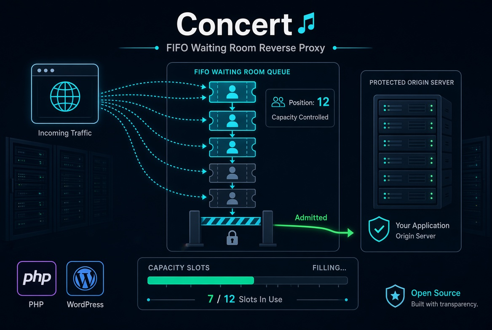

# Concert

 

A FIFO waiting room reverse proxy. Put Concert in front of any HTTP origin, such as a PHP site, a WordPress install, or a legacy app that falls over under load. When traffic exceeds what the origin can handle, visitors wait in an orderly queue with a live position instead of getting 502s and timeouts. Admitted visitors load their page's assets through a separate tier that queued and denied visitors can't reach, and clients that misbehave are blocked for an escalating cooldown.

Concert is a single Go binary built on:

- [room](https://github.com/andreimerlescu/room), a FIFO waiting room middleware for Gin
- [sema](https://github.com/andreimerlescu/sema), a resizable semaphore
- the `ess` package of [naddr](https://github.com/andreimerlescu/naddr), which tells the admin portal who owns every address it shows: country flag, ASN, network, and the IPv4, IPv6 and IPv8 forms

## Why

A PHP-FPM pool has a fixed number of workers (`pm.max_children`). When every worker is busy, new requests pile up in the web server's backlog until they time out. Users see 502 or 504 errors, hit refresh, and make the spike worse.

Concert caps the number of concurrent page requests that reach your origin. Everyone past that cap is shown a waiting room page with their queue position, and they are admitted automatically, in arrival order, as slots free up. Your origin only ever sees the load you chose.

## How it works

    browser ──▶ TLS terminator ──▶ concert :8080 ──▶ origin :3000
                                      │
              every request ──────────┼─▶ client banned? ──▶ 429 until the cooldown ends (403 if permanent)
                                      │   ban path? ──────▶ ban now, 429
                                      │
              page requests ──────────┼─▶ room: slot free?
                                      │     yes ──▶ proxied, concert_admit pass issued
                                      │     no  ──▶ waiting room page, polls /queue/status
                                      │
              asset requests ─────────┼─▶ valid concert_admit pass?
                                      │     no  ──▶ 403
                                      │     yes ──▶ per-user semaphore (HTTP/1.1 or HTTP/2 rule)
                                      │               ──▶ global asset semaphore ──▶ proxied
                                      │
              stream paths ───────────┼─▶ valid pass and a free stream slot ──▶ proxied, outside the room
                                      │
              bypass paths ───────────┴─▶ proxied, no guard

**Every request** is first matched to a client address. Banned clients are rejected before anything else runs.

**Pages** go through room. A request whose ticket falls inside the serving window takes a slot, is proxied, and releases the slot when its response has been fully delivered. Other requests get a `room_ticket` cookie and the waiting room page, which polls `/queue/status` and reloads when the visitor's turn arrives. `-cap` is the maximum number of page requests in flight to your origin.

**Admitted page responses** also carry `concert_admit`, a signed, HttpOnly pass that slides forward as the visitor keeps browsing.

**Assets** don't queue. A stylesheet or image can't run the waiting room's JavaScript, so making one wait is the same as failing it. Instead, asset paths require a valid pass, and each pass has its own small concurrency pool. One visitor can't monopolise the asset tier, and visitors who were never admitted can't touch it at all. A global semaphore across all passes protects the host.

## Editions (Three Purpose-Built Binaries)

`make build` compiles three deduplicated binaries from shared `internal/` packages (plus `bench-concert`), keeping lean binaries free of blockchain/gRPC/enterprise dependencies via Go build tags:

| Binary | Build Command | What's Included |
| --- | --- | --- |
| **`concert`** | `go build ./cmd/concert` | Lean HTTP/HTTPS waiting-room front-door: FIFO waiting room (`room`), `sema` capacity + asset/stream tiers, `Concert-Priority`, `os.Root` local static serving + `.br`/`.gz`/gzip, ACME TLS + `:80→:443` redirect + opt-in `-http3`, declarative `-config` (`Concertfile`/`.json`) multi-vhost with `SIGHUP` hot-reload, abuse registry, single-password Portal (with multi-vhost site switcher), Prometheus `/metrics`, `bench` |
| **`wpconcert`** | `go build -tags wordpress ./cmd/wpconcert` | Everything in `concert` **+** pure-stdlib FastCGI (`fcgi://`, `fcgi+unix://`), WordPress/WooCommerce `preset wordpress`, bounded in-memory anonymous GET micro-cache with `singleflight` stampede collapse (`-micro-cache-ttl`), and `wpconcert doctor` / `wpconcert init` PHP-FPM pool sizing tools — **zero** blockchain/gRPC/enterprise mesh deps |
| **`econcert`** | `go build -tags "wordpress,enterprise" ./cmd/econcert` | Complete open-source enterprise superset: `concert` + `wpconcert` **+** two-tier edge/leaf hop mesh (`Concert-Hop` nonces + native leaf mTLS + traffic-weighted multi-edge + drained remote re-benchmarking), Redis HA cluster sync & alert dedupe, RBAC/SSO + tamper-evident audit log + `-enterprise-hardened`, transactional email digest mailer, and 4-chain x402 / Direct QR / NFT & token-gated Fast-Lane (`reconcile`, `archive-receipts`) |

## Install

    go install github.com/andreimerlescu/concert/cmd/concert@latest
    go install -tags wordpress github.com/andreimerlescu/concert/cmd/wpconcert@latest
    go install -tags "wordpress,enterprise" github.com/andreimerlescu/concert/cmd/econcert@latest

Or build the Linux static binaries, FIPS builds, release tarballs, and per-edition CycloneDX SBOMs from source:

    git clone https://github.com/andreimerlescu/concert.git
    cd concert
    make build
    make dist

`make build` writes static Linux binaries (`linux/amd64` and `linux/arm64`) for `concert`, `wpconcert`, `econcert`, `bench-concert`, and `concert-client` to `bin/`. `make dist` packages Linux release `.tar.gz` tarballs (including FIPS 140-3 builds), CycloneDX 1.5 SBOMs, and `SHA256SUMS.txt` into `dist/`. For local development on another OS, build directly with `go build ./cmd/concert`. Requires Go 1.27.3 or newer (`room v1.9.0` / `sema v1.3.0`).

On RHEL, Alma, Rocky, CentOS Stream or Fedora, `installer.sh` installs a prebuilt binary as a confined systemd service under SELinux enforcing mode, downloads the IPtoASN database for IP details, and schedules its daily refresh. See the comments at the top of the script.

## Quick start

Start something to protect. PHP's built-in server is enough for a demo:

    php -S 127.0.0.1:3000 -t /var/www/html

Put Concert in front of it with a deliberately small capacity:

    concert -upstream http://127.0.0.1:3000 -cap 5 -assets "/css/*,/js/*,/images/*"

Open `http://127.0.0.1:8080/` in a browser, then generate load from another terminal:

    ab -c 100 -n 2000 http://127.0.0.1:8080/

Refresh the browser while the load test runs and you'll land in the waiting room, then be admitted automatically as slots open.

To watch it from the admin portal with IP details, also set:

    curl -fsSL -o ip2asn-combined.tsv.gz https://iptoasn.com/data/ip2asn-combined.tsv.gz
    export NADDR_DATA=$PWD/ip2asn-combined.tsv.gz
    export CONCERT_PORTAL_PASS=$(openssl rand -hex 16)

and open `http://127.0.0.1:8081/`.

## Configuration

Every option can be set with a flag or an environment variable. A flag overrides its environment variable, and the environment variable overrides the built-in default. Values changed in the admin portal are saved to `settings.json` and override both; see [Persistent settings, bans, queue and history](#persistent-settings-bans-queue-and-history).

| Flag | Environment | Default | Description |
|---|---|---|---|
| `-config` | `CONCERT_CONFIG` | *(empty)* | Declarative multi-vhost config file (`Concertfile` or `.json`); source of truth reloaded on `SIGHUP` |
| `-listen` | `CONCERT_LISTEN` | `:8080` | Address to listen on (restart to change) |
| `-http3` | `CONCERT_HTTP3` | `false` | Serve HTTP/3 (QUIC) on UDP `-listen` alongside TCP HTTPS and advertise `Alt-Svc` (requires TLS; restart to change) |
| `-upstream` | `CONCERT_UPSTREAM` | `http://127.0.0.1:3000` | Origin to proxy to (`http://`, `https://`; `fcgi://host:port` and `fcgi+unix:///path/to/php-fpm.sock` in `wpconcert`/`econcert`) |
| `-static-root` | `CONCERT_STATIC_ROOT` | *(empty)* | Local document root served off disk via `os.Root` (also FastCGI `DOCUMENT_ROOT`; restart to change) |
| `-static-mounts` | `CONCERT_STATIC_MOUNTS` | *(empty)* | Comma-separated `/prefix=/dir` static asset mounts confined by `os.Root` (restart to change) |
| `-static-allow-ext` | `CONCERT_STATIC_ALLOW_EXT` | *(empty)* | Extra safe file extensions added to the static allowlist (scripts & secrets stay hard-blocked) |
| `-static-cache-control` | `CONCERT_STATIC_CACHE_CONTROL` | `public, max-age=3600` | `Cache-Control` header applied to locally served static files |
| `-static-fallback` | `CONCERT_STATIC_FALLBACK` | `false` | Forward missing mounted/asset static files upstream instead of fast `404` |
| `-compress` | `CONCERT_COMPRESS` | `true` | On-the-fly stdlib `gzip` (`>= 1 KiB`) for locally served static files and FastCGI responses |
| `-fcgi-index` | `CONCERT_FCGI_INDEX` | `index.php` | `wpconcert`/`econcert`: entrypoint script for FastCGI `try_files` fallback and directory index |
| `-fcgi-deny-paths` | `CONCERT_FCGI_DENY_PATHS` | `/wp-content/uploads/*,/wp-config.php` | `wpconcert`/`econcert`: paths blocked from FastCGI PHP execution (`403`; restart to change) |
| `-micro-cache-ttl` | `CONCERT_MICRO_CACHE_TTL` | `0s` | `wpconcert`/`econcert`: in-memory anonymous GET/HEAD page micro-cache TTL with stampede collapse (e.g. `15s`) |
| `-micro-cache-max-mb` | `CONCERT_MICRO_CACHE_MAX_MB` | `64` | `wpconcert`/`econcert`: memory ceiling in MiB for the anonymous GET micro-cache |
| `-wp-preset` | `CONCERT_WP_PRESET` | `false` | `wpconcert`/`econcert`: apply WordPress/WooCommerce asset gating, `/xmlrpc.php` block, and uploads PHP denial |
| `-cap` | `CONCERT_CAPACITY` | `434` | Max concurrent page requests allowed through to the origin |
| `-max-queue` | `CONCERT_MAX_QUEUE` | `369` | Reject new arrivals with 503 beyond this queue depth (0 = unlimited) |
| `-reaper` | `CONCERT_REAPER` | `10s` | How often abandoned tickets are cleaned up (`5s`–`24h`) |
| `-token-ttl` | `CONCERT_TOKEN_TTL` | `0` (room default, 5m) | Sliding lifetime of a queued ticket, 30s–24h |
| `-first-poll-grace` | `CONCERT_FIRST_POLL_GRACE` | `30s` | Reclaim a new ticket whose visitor never polls (0 = off) |
| `-ready-grace` | `CONCERT_READY_GRACE` | `30s` | Reclaim a ticket inside the serving window that is not claimed in time, `5s`–`10m` (0 = off) |
| `-idle-poll-ttl` | `CONCERT_IDLE_POLL_TTL` | `45s` | Evict a queued ticket with no client contact for longer than this time, `10s`–`24h` (0 = off) |
| `-busy-html` | `CONCERT_BUSY_HTML` | *(empty)* | Custom HTML file served when the waiting room is full (`503`), empty for built-in busy page |
| `-clear-queue-on-start` | `CONCERT_CLEAR_QUEUE_ON_START` | `false` | Discard any saved `queue.snapshot` on startup instead of restoring it (restart to change) |
| `-secure-cookie` | `CONCERT_SECURE_COOKIE` | `false` | Mark cookies `Secure` (only if browsers reach you over HTTPS) |
| `-cookie-path` | `CONCERT_COOKIE_PATH` | `/` | Path attribute of cookies |
| `-cookie-domain` | `CONCERT_COOKIE_DOMAIN` | *(empty)* | Domain attribute of cookies |
| `-preserve-host` | `CONCERT_PRESERVE_HOST` | `true` | Forward the client's `Host` header to the origin |
| `-trusted-proxies` | `CONCERT_TRUSTED_PROXIES` | `127.0.0.1/32,::1/128` | CIDRs whose `X-Forwarded-For` and `X-Forwarded-Proto` are trusted |
| `-bypass` | `CONCERT_BYPASS` | `/favicon.ico` | Paths that skip every guard; suffix `/*` for a prefix |
| `-assets` | `CONCERT_ASSETS` | *(empty)* | Asset paths that require an admission pass |
| `-asset-public` | `CONCERT_ASSET_PUBLIC` | *(empty)* | Asset paths served without a pass, still under the global asset cap |
| `-asset-cap` | `CONCERT_ASSET_CAP` | `0` (derived) | Global concurrent asset requests; 0 means `cap × asset-user-cap-h2` |
| `-asset-wait` | `CONCERT_ASSET_WAIT` | `2s` | Max wait for a global asset slot before 503 |
| `-asset-user-cap-h1` | `CONCERT_ASSET_USER_CAP_H1` | `8` | Concurrent asset requests per pass over HTTP/1.x |
| `-asset-user-cap-h2` | `CONCERT_ASSET_USER_CAP_H2` | `128` | Concurrent asset requests per pass over HTTP/2 and HTTP/3 |
| `-asset-user-wait` | `CONCERT_ASSET_USER_WAIT` | `2s` | Max wait for a per-pass asset slot before 429 |
| `-admit-ttl` | `CONCERT_ADMIT_TTL` | `10m` | Sliding lifetime of the admission pass (minimum 30s) |
| `-client-proto-header` | `CONCERT_CLIENT_PROTO_HEADER` | *(empty)* | Header from a trusted TLS terminator carrying the client's HTTP protocol |
| `-stream-paths` | `CONCERT_STREAM_PATHS` | *(empty)* | WebSocket and SSE paths served outside the room, admission pass required |
| `-stream-cap` | `CONCERT_STREAM_CAP` | `1000` | Most stream connections open at once |
| `-priority-cap` | `CONCERT_PRIORITY_CAP` | `0` (a quarter of `-cap`) | Priority lane slots, on top of `-cap` |
| `-priority-lane-rank` | `CONCERT_PRIORITY_LANE_RANK` | `3` (customer) | Lowest rank that uses the priority lane |
| `-priority-wait` | `CONCERT_PRIORITY_WAIT` | `5s` | Longest wait for a lane slot before joining the line |
| `-priority-forms` | `CONCERT_PRIORITY_FORMS` | `true` | Forms from admitted visitors use the lane, and get 503 instead of queuing |
| `-priority-order-line` | `CONCERT_PRIORITY_ORDER_LINE` | `true` | Place ranked visitors who wait ahead of lower ranks; `false` keeps strict arrival order |
| `-abuse` | `CONCERT_ABUSE` | `true` | Enable the abuse registry |
| `-abuse-strikes` | `CONCERT_ABUSE_STRIKES` | `20` | Strike total within the window that triggers a ban |
| `-abuse-window` | `CONCERT_ABUSE_WINDOW` | `1m` | Window over which strikes accumulate |
| `-abuse-cooldown` | `CONCERT_ABUSE_COOLDOWN` | `5m` | First ban length; doubles with each repeat ban |
| `-abuse-max-cooldown` | `CONCERT_ABUSE_MAX_COOLDOWN` | `24h` | Longest ban; also how long ban history is remembered |
| `-abuse-max-entries` | `CONCERT_ABUSE_MAX_ENTRIES` | `100000` | Max clients tracked at once |
| `-abuse-allow` | `CONCERT_ABUSE_ALLOW` | *(empty)* | CIDRs that are never struck or banned |
| `-ban-paths` | `CONCERT_BAN_PATHS` | *(empty)* | Paths that ban the client on first hit |
| `-access-log` | `CONCERT_ACCESS_LOG` | `true` | Write an access log line per non-asset request |
| `-html` | `CONCERT_HTML_FILE` | *(empty)* | Custom waiting room HTML file |
| `-skip-url` | `CONCERT_SKIP_URL` | *(empty)* | Payment page URL for the skip-the-line card (see limitations) |
| `-rate` | `CONCERT_RATE` | `0` | Base price per queue position (0 disables skip-the-line) |
| `-surge` | `CONCERT_SURGE` | `0` | Extra price per position for each client in the queue |
| `-pass` | `CONCERT_PASS_DURATION` | `0` | VIP pass lifetime after paying to skip (0 disables passes) |
| `-agent-queue` | `CONCERT_AGENT_QUEUE` | `false` | With wallet access on, a valid `Concert-Session` header keeps one place in line per session, with no cookies; see [AI agents in the line](#ai-agents-in-the-line) |
| `-agent-places` | `CONCERT_AGENT_PLACES` | `4` | Places in line one client address (IPv6: its /64) may hold through `Concert-Session`; past it, 429 and a strike |
| `-upstream-timeout` | `CONCERT_UPSTREAM_TIMEOUT` | `60s` | How long to wait for the origin's response headers (`90s` in WordPress preset) |
| `-upstream-body-idle-timeout` | `CONCERT_UPSTREAM_BODY_IDLE_TIMEOUT` | `30s` | Max idle pause between upstream response body chunks on non-stream requests, `1s`–`24h` (0 disables; exempts `-stream-paths`, SSE, and `101`) |
| `-api-json` | `CONCERT_API_JSON` | `true` | Answer queued non-browser clients with JSON 429 instead of HTML |
| `-retry-after` | `CONCERT_RETRY_AFTER` | `5` | `Retry-After` seconds sent to queued API clients |
| `-tls-domains` | `CONCERT_TLS_DOMAINS` | *(empty)* | Hostnames to get Let's Encrypt certificates for; enables TLS on `-listen` |
| `-tls-http-listen` | `CONCERT_TLS_HTTP_LISTEN` | *(empty)* | Companion plain-HTTP address (e.g. `:80`) for ACME HTTP-01 and HTTPS redirect (restart to change) |
| `-tls-email` | `CONCERT_TLS_EMAIL` | *(empty)* | ACME contact email |
| `-tls-cache` | `CONCERT_TLS_CACHE` | `/var/lib/concert/acme` | ACME account key and certificate directory |
| `-tls-staging` | `CONCERT_TLS_STAGING` | `false` | Use the Let's Encrypt staging directory |
| `-portal-listen` | `CONCERT_PORTAL_LISTEN` | `127.0.0.1:8081` | Admin portal address (restart to change) |
| `-portal-allow` | `CONCERT_PORTAL_ALLOW` | `127.0.0.1/32,::1/128` | CIDRs allowed to reach the portal |
| `-portal-session-ttl` | `CONCERT_PORTAL_SESSION_TTL` | `8h` | Portal sign-in lifetime |
| `-portal-secure-cookie` | `CONCERT_PORTAL_SECURE_COOKIE` | `false` | Mark the portal session cookie `Secure` |
| `-history-log` | `CONCERT_HISTORY_LOG` | *(empty)* | Portal history log file; empty means `history.jsonl` in `-data-dir`, `off` for memory only (restart to change) |
| `-data-dir` | `CONCERT_DATA_DIR` | `/var/lib/concert/data` | Directory for settings, bans, the saved queue and the history log (empty disables persistence) |
| `-version` | | | Print the version and exit |
| | `CONCERT_ADMIN_TOKEN` | *(empty)* | Bearer token for the admin endpoints; they are disabled when unset |
| | `CONCERT_ADMIT_SECRET` | *(random)* | Key that signs admission passes and priority grants; at least 32 bytes |
| | `CONCERT_PORTAL_PASS` | *(empty)* | Admin portal password, at least 16 characters; the portal is off without it |
| | `NADDR_DATA` | *(empty)* | IPtoASN file for IP details in the portal (plain or `.gz`) |
| | `NADDR_DATA_POLL` | `30s` | How often `NADDR_DATA` is checked for changes; `off` disables reloading |
| | `NADDR_ADDR` | *(empty)* | A running naddr service (`host:port` or URL), used when `NADDR_DATA` is empty or unusable |

The settings for running Concert as an edge in front of leaf Concerts (`-role`, `-node-id`, `-hop-*`, `-host-cap`, `-upstream-retries`, `-bench-*` and `CONCERT_HOP_SECRET`) are listed in [docs/TOPOLOGY.md](docs/TOPOLOGY.md#configuration). For running WordPress/WooCommerce directly on Concert + `php-fpm` without Caddy, Nginx, or Apache, see [docs/WORDPRESS.md](docs/WORDPRESS.md). For production baselines, capacity calibration, live queue recovery (`POST /_room/queue/clear`), and alerting, see [docs/OPERATIONS.md](docs/OPERATIONS.md).

Secrets are environment-only on purpose: command-line arguments are visible in `ps` output and shell history.

When `CONCERT_ADMIT_SECRET` is unset, Concert generates a random key at startup. Passes then stop working on restart, and a second instance won't accept the first instance's passes. Set it explicitly in production:

    openssl rand -base64 48

## Choosing a page capacity

`-cap` counts concurrent page requests, not users. A slot is held from the moment a request is admitted until the last byte of the origin's response has been sent to the client.

For a PHP-FPM origin, start with `-cap` at or slightly below the pool's `pm.max_children`. Concert then admits only as many requests as there are workers to run them, and the backlog lives in Concert's queue, where users can see their position, instead of in a socket buffer where they can't.

Throughput follows from Little's law: requests admitted per second ≈ `cap` ÷ average time a slot is held. With `-cap 50` and a 200 ms average response, Concert admits about 250 requests per second. If the origin slows down under load, admissions slow down with it, which is exactly the protection you want.

Page capacity can be changed at runtime without a restart, in the portal or with `POST /_room/cap`.

## Client addresses and trusted proxies

Behind nginx or a load balancer, every connection to Concert comes from the proxy. `-trusted-proxies` lists the addresses Concert should look past.

When a connection comes from a trusted proxy, Concert reads `X-Forwarded-For` from right to left and takes the first address that isn't itself a trusted proxy. Addresses further left were written by the client and are ignored. When a connection comes from anywhere else, its own address is the client, and any forwarded headers it sent are discarded.

The same rule decides what the origin sees. For trusted hops, Concert appends to the incoming `X-Forwarded-For` chain and keeps `X-Forwarded-Proto`, so your application gets real client IPs and knows the visitor used HTTPS. From untrusted peers, both are replaced.

The default trusts loopback only. That is safe even when Concert faces the internet directly, because internet connections never arrive from loopback. Add your load balancer's range if it runs on another host:

    -trusted-proxies "127.0.0.1/32,::1/128,10.0.0.0/8"

## Admin portal

Set `CONCERT_PORTAL_PASS` and the portal listens on `-portal-listen` (default `127.0.0.1:8081`) for addresses in `-portal-allow`. It has eight tabs:

| Tab | Shows |
|---|---|
| Overview | Page, asset, stream, priority, abuse, and live Edge/Leaf tier views (with drained re-benchmarking and `draining` shrink badge) |
| Queue | Visitors waiting in line, with actions to move to the front, remove, remove and ban, flush stale tickets, or clear the queue |
| Bans | Active bans and ranges; create, change or lift a ban, temporary or permanent |
| Visitors | Every client the history recorded, with its requests and the bans covering it |
| Ban log | Every ban in the history: when it began and ends, what started it, and what the banned network requested while blocked |
| Fast lane | x402 payment offers, NFT collection rules, receipt journal headroom alerts, and one-click zero-downtime online reconciliation |
| Email | Administrator email delivery (SMTP, Resend, or SendPanda), DNS & handshake verifier, test delivery, compliance links, cadence scheduler, and queued event digest |
| Settings | Every setting, where its value comes from, and a form to change it live |

The Queue, Bans, Visitors and Ban log tables are rendered on the server one page at a time (25 rows by default; 50 and 100 are offered) and only the visible tab updates, every 3 seconds. Rows that move within the page slide to their new place, rows arriving are labeled with where they came from, and rows leaving say which page they moved to. Hovering over a table pauses its updates, each tab has a **Live** switch, and `prefers-reduced-motion` turns the motion off. Expanding a row loads its detail once and reloads it only when the row itself changes.

Visitors rows are tinted by state: red for a permanent ban, amber for a temporary one, green when the last response was 2xx, and blue otherwise.

### IP details

Every address in the portal shows, when the IP database knows it:

- the country's flag emoji, with the country name as a tooltip
- the ASN and network description
- badges for the address forms: **4** and **8** for an IPv4 client, **6** for an IPv6 client. The tooltip shows the address, and the **8** tooltip shows both IPv8 forms (8-octet and ASN dot). Click a badge to copy the address.

Expanded rows also show the containing IPv4 or IPv6 range and its IPv8 range. IPv8 follows the Internet-Draft `draft-thain-ipv8-02`, as implemented by naddr's `ess` package.

Concert gets IP details from, in order:

1. `NADDR_DATA`, a local copy of the [IPtoASN](https://iptoasn.com/) combined database, plain or gzip. It is loaded into memory and answers in microseconds. A replaced file is reloaded every `NADDR_DATA_POLL` without a restart; replace it atomically (download to a temporary file in the same directory, then `mv`).
2. `NADDR_ADDR`, a running naddr service. Concert asks its `/ip` endpoint in the background and caches answers for an hour.

With neither, the portal shows bare addresses and nothing else changes. When `NADDR_DATA` is set but can't be loaded yet, for example while the first download is still running, Concert tries again every minute and switches to it once it loads. The portal's navigation bar and the Settings tab show which source is in use.

Concert never downloads the database itself. `installer.sh` downloads it to `/var/lib/concert/naddr/`, labels it for SELinux, and installs a daily `concert-naddr-data.timer` that refreshes it. Elsewhere:

    curl -fsSL -o /var/lib/concert/naddr/.new https://iptoasn.com/data/ip2asn-combined.tsv.gz
    gzip -t /var/lib/concert/naddr/.new
    mv /var/lib/concert/naddr/.new /var/lib/concert/naddr/ip2asn-combined.tsv.gz

The IPtoASN data is governed by its provider's terms.

### Request history

The access log goes to stdout and never sees banned clients, because bans are enforced before it runs. The portal's history does. It keeps:

- every request the access log records
- every request from a banned client
- the request that started each ban
- every 4xx or 5xx response, including on asset paths

It keeps the last 100 requests from each of up to 4,096 addresses, for 72 hours after an address's last request, and each ban for 72 hours after it ends. Successful asset and waiting-room status requests are left out, as they are from the access log.

## Persistent settings, bans, queue and history

Concert keeps these files in `-data-dir` (default `/var/lib/concert/data`), created with mode `0600`:

| File | Holds |
|---|---|
| `settings.json` | Settings changed in the admin portal or with `POST /_room/cap` |
| `bans.json` | Every ban, permanent bans, and offense history |
| `hop-bans.json` | On a leaf: which bans each edge applied, so they are lifted when the edge lifts them |
| `capacity.json` | On a leaf: host capacity measured by `bench-concert` or `-bench-on-start` |
| `bench-report.json` | On a leaf: full JSON report from `-bench-on-start` |
| `silence.jsonl` | On a leaf: silence and recovery reports when the application stops answering (rotated at 16 MiB) |
| `email-secrets.json` | AES-256-GCM encrypted SMTP password / Resend / SendPanda API keys entered through the portal |
| `email-queue.json` | Coalesced pending alert events, rolling digest send timestamps, and per-recipient pause state |
| `queue.snapshot` | The waiting line, saved on shutdown and restored on start |
| `history.jsonl` | The portal's request history and ban log |

Each setting takes the first value it finds, in this order:

    settings.json  >  command-line flag  >  CONCERT_* environment variable  >  built-in default

`settings.json` only holds values an operator changed, so everything else keeps following your flags and `concert.env`. **Reset** in the portal removes a value from the file. Every change is validated by building a complete new configuration before it is written, so a saved file always starts. If you edit the file by hand and Concert refuses to start, the error names the file: fix it or delete it.

Every setting applies immediately, without a restart, except the listen address, the portal address and the history log, which are set in `concert.env` and take a restart. Secrets (`CONCERT_ADMIN_TOKEN`, `CONCERT_ADMIT_SECRET`, `CONCERT_PORTAL_PASS`), `-data-dir` itself and the IP database (`NADDR_*`) are never stored in the file.

Bans are restored at startup. Administrator bans are written before the API answers; automatic bans within a second. Addresses added to `-abuse-allow` since a ban was made are not restored as banned. A corrupt `bans.json` stops startup rather than silently lifting permanent bans. Set `-data-dir ""` to keep everything in memory.

### The history log

With `-data-dir` set, the history is also written to `history.jsonl` (`-history-log` moves it, or turns it off with `off`), so an attack that ended in a restart still shows who was banned and what they probed. Each line is one JSON event:

| `t` | Event |
|---|---|
| `req` | A recorded request, with what `ess` said about its address (`ess`: country, ASN, description, range, IPv8 form) |
| `agg` | Requests a banned client made past its first 100 during a ban, counted per path once a second |
| `ban` | A ban began or changed (the full state; the latest line wins) |
| `lift` | A ban was lifted early |
| `trig` | The request that started a ban, when it was identified afterwards |

For example:

    {"t":"req","at":"2026-09-26T21:18:20.1Z","ip":"203.0.113.9","method":"GET","path":"/.env","status":429,"latency_us":83,"ua":"curl/8.5","triggered":true,"ban":12,"ess":{"cc":"LT","country":"Lithuania","n":218785,"asn":"AS218785","desc":"UAB Cherry Servers","range":"203.0.113.0/24","ip8":"0.3.86.161.203.0.113.9"}}

Writes go through a buffer flushed every second, so a request never waits for the disk; under extreme load events that don't fit are dropped and counted (see Settings → History log). A flood from a banned client is written one line per request for its first 100 requests during that ban, then summarised once a second, so an attack can't fill the disk. The file rotates at 64 MB, keeping four older files (`history.jsonl.1` is the newest).

On startup the files are replayed oldest first: requests older than 72 hours are skipped, and bans still in force are matched with `bans.json`. The replay takes a few seconds for a full set of files.

### Permanent bans

The portal's ban dialog has a **Permanent** switch, for single addresses and ranges alike. A permanently banned client gets `403 Forbidden` with `{"error":"blocked","permanent":true}`, or a short HTML notice in a browser, until someone unbans it.

### Bans drop waiting visitors

Any new ban, whether from the portal, a ban path or strikes, removes that address's or range's visitors from the line at once. Their next `/queue/status` poll returns `ready:true`, so the waiting room page reloads straight into the block notice, and their `room_ticket` is invalidated so an unban means rejoining at the back.

## Assets

List the paths that hold your stylesheets, scripts, fonts and images in `-assets`:

    concert -upstream http://127.0.0.1:3000 \
            -assets "/wp-content/themes/*,/wp-content/plugins/*,/wp-includes/*" \
            -asset-public "/wp-content/uploads/*"

### The admission pass

Every page response that room admits carries `concert_admit`: an HttpOnly cookie holding a random ID, an expiry, a key identifier and an HMAC signature. Checking it costs one HMAC and no lookup, so any instance sharing `CONCERT_ADMIT_SECRET` accepts it.

The pass slides. It is re-signed once it is past half of `-admit-ttl`, on either a page load or an asset request. Visitors who keep browsing stay admitted, while most responses carry no `Set-Cookie` header and stay cacheable.

An asset request without a valid pass gets `403 Forbidden` immediately. It never waits and never reaches your origin.

A pass signed with a different key is treated as stale, not forged. After a restart or a secret rotation, returning visitors get 403 on assets until their next page load issues a fresh pass, but they never earn abuse strikes for it.

### Per-user concurrency: HTTP/1.1 and HTTP/2

Each pass gets its own semaphores, so one visitor can have at most a fixed number of asset requests in flight. Browsers behave very differently on each protocol, so there are two rules.

**HTTP/1.1** browsers open about 6 connections per host, so their natural concurrency is about 6. The default `-asset-user-cap-h1 8` leaves a little slack.

**HTTP/2 and HTTP/3** browsers send every request at once over one connection, up to the server's stream limit (nginx's `http2_max_concurrent_streams` defaults to 128). The default `-asset-user-cap-h2 128` matches that.

A request that finds its pool full waits up to `-asset-user-wait`, then gets `429 Too Many Requests` with `Retry-After: 1`. Each pass keeps a separate pool per protocol family, created on first use.

**Behind a TLS terminator, Concert can't see the client's protocol.** Browsers only speak HTTP/2 over TLS, and the terminator talks to Concert over HTTP/1.1 no matter what the browser used. Have the terminator pass the protocol in a header, and name that header with `-client-proto-header`:

    proxy_set_header X-Client-Proto $server_protocol;

    concert -client-proto-header X-Client-Proto ...

Values starting with `HTTP/1` use the HTTP/1.1 rule, and `HTTP/2` or `HTTP/3` use the HTTP/2 rule. Anything else falls back to the protocol of Concert's own connection. Only enable this when a terminator you control sets the header, since it overwrites whatever the client sent. When Concert terminates TLS itself (`-tls-domains`), it sees the protocol directly and needs no header.

### Global asset concurrency

After its per-user check, every asset request takes a slot from one global semaphore. By default its size is `cap × asset-user-cap-h2`: with `-cap 1200` and `-asset-user-cap-h2 200`, the asset cap is 240,000. Set `-asset-cap` to override it with a number that reflects what your asset tier can actually serve. A request that can't get a global slot within `-asset-wait` gets `503 Service Unavailable` with `Retry-After: 1`.

The per-user check runs first, so a client over its own limit is rejected before it can take a global slot.

### Public assets

Some assets are fetched by things that never loaded a page first:

- link-preview crawlers from Slack, iMessage, Facebook and LinkedIn fetching your `og:image`
- email clients rendering newsletter images
- RSS readers
- other sites embedding your images

List those paths in `-asset-public`. They skip the pass check but still count against the global asset semaphore.

### Logging

The asset path writes no log lines; activity is counted in `/_room/stats`. Asset paths, `/queue/status` and `/_room/healthz` are also left out of the access log, and `-access-log=false` turns the access log off entirely.

## Streams

WebSocket and server-sent event connections can stay open for hours. In the waiting room each one would hold a page slot for its whole life. Paths listed in `-stream-paths` are served outside the room instead, with two guards of their own:

- **A valid admission pass.** Only visitors already admitted to a page can open a stream, so nobody skips the line through one.
- **A global cap of `-stream-cap` connections.** When it is full, new connections get `503` with `Retry-After`; stream clients reconnect on their own.

A forged pass earns the same strike as on the asset tier.

## Abuse registry

Concert keeps a registry of clients that misbehave. Each abusive act adds weighted strikes to the client's address. When a client's strikes within `-abuse-window` reach `-abuse-strikes`, it is banned for a cooldown. While banned, every request from it gets:

    HTTP/1.1 429 Too Many Requests
    Retry-After: 300
    Content-Type: application/json; charset=utf-8
    Cache-Control: no-store

    {"error":"temporarily blocked","retry_after_seconds":300}

Enforcement happens before anything else: before the queue, the asset tier, the operations endpoints and the access log. It is a single map lookup, and banned requests are not logged (the portal's history records them).

### What earns strikes

| Behaviour | Strikes | Why it signals abuse |
|---|---|---|
| Admission pass with a bad signature | 5 | Browsers never alter the pass; someone is tampering with it |
| Wrong admin token | 5 | Someone is guessing `CONCERT_ADMIN_TOKEN` |
| Per-user asset pool exhausted | 1 | One pass is sending far more concurrent requests than a browser would |
| Queued without a `room_ticket` cookie | 1 | A script is discarding cookies to take fresh places in line |

With the defaults, 20 strikes within one minute trigger a ban. That is four forged passes, four wrong admin tokens, or twenty cookie-less queue arrivals.

These never earn strikes: missing passes (link-preview crawlers), expired or stale passes (idle visitors, restarts), and the global asset limit (not any one client's fault). Queued visitors who keep their `room_ticket` cookie never earn churn strikes, however long they wait.

### Ban paths

`-ban-paths` lists paths no legitimate visitor to your site ever requests. A client that requests one is banned immediately, without accumulating strikes. On a PHP site these are typically vulnerability scanners probing for secrets and admin tools:

    -ban-paths "/.env,/.git/*,/.aws/*,/.DS_Store,/phpmyadmin/*,/pma/*,/wp-config.php.bak,/server-status"

Only list paths your site genuinely never serves. Don't list `/wp-login.php` or `/xmlrpc.php` on WordPress: real users and plugins such as Jetpack use them. A path may not appear in both `-ban-paths` and any other path flag.

### Escalating cooldowns

The first ban lasts `-abuse-cooldown`. Each later ban of the same client doubles it, up to `-abuse-max-cooldown`: with the defaults, 5 minutes, then 10, 20, 40, and so on to 24 hours. A client whose last ban ended more than `-abuse-max-cooldown` ago, with no strikes since, is forgotten and starts from the beginning.

### Range bans

Administrators can ban a whole CIDR range from the portal or the admin API, as broad as `/8` for IPv4 and `/16` for IPv6. Ranges are never banned by strikes. Addresses in `-abuse-allow` and `-trusted-proxies` stay reachable inside a banned range.

### Who is never banned

Addresses in `-abuse-allow` and in `-trusted-proxies` are never struck or banned. List your monitoring systems, your office, and your own address there, so an operator mistake can't lock you out of the admin endpoints. Trusted proxies are exempt because they only appear as the client when a request carries no forwarding headers, such as nginx's own health checks.

Think carefully about shared addresses. Behind carrier-grade NAT or a large office network, thousands of real people can share one IPv4 address, and their strikes add up together. If you expect heavy traffic from such networks, add their ranges to `-abuse-allow` or raise `-abuse-strikes`. The portal's IP details help here: the ASN and description show when an address belongs to a mobile carrier or a large network.

IPv6 clients are tracked by their `/64` prefix, because a single IPv6 host can rotate through billions of addresses in its own `/64`.

### Memory

At most `-abuse-max-entries` clients are tracked. When the table is full, a new client replaces an unbanned entry if one is available; otherwise its strikes are dropped and counted in `abuse_dropped_total`. Existing bans are never evicted to make room.

## Bypass paths

`-bypass` sends matching paths straight to the origin with no pass, no queue and no semaphore. Banned clients are still rejected. Use it only for traffic that has no admitted visitor behind it and can't tolerate a queue:

    -bypass "/favicon.ico,/robots.txt,/.well-known/acme-challenge/*,/webhooks/*"

That covers payment-provider webhooks, certificate renewal challenges and uptime checks. Bypassed paths are otherwise unprotected, so never bypass anything that runs expensive application code.

A path may appear in only one of `-bypass`, `-assets`, `-asset-public`, `-stream-paths` and `-ban-paths`. Overlapping or conflicting entries are rejected at startup.

## API and non-browser clients

Browsers get the HTML waiting room. Any request whose `Accept` header does not include `text/html` gets a machine-readable response instead:

    HTTP/1.1 429 Too Many Requests
    Content-Type: application/json; charset=utf-8
    Retry-After: 5
    Set-Cookie: room_ticket=…; Path=/; HttpOnly; SameSite=Lax

    {"hint":"keep the room_ticket cookie and retry to hold your position","queued":true,"retry_after_seconds":5,"status_url":"/queue/status"}

A client that keeps cookies holds its place in line across retries:

    curl -c jar -b jar https://example.com/api/orders      # 429, ticket issued
    curl -c jar -b jar https://example.com/queue/status    # {"ready":false,"position":12,...}
    curl -c jar -b jar https://example.com/api/orders      # 200 once ready

A client that discards cookies takes a new ticket on every retry and earns a churn strike each time. With the defaults, twenty retries within a minute ban it.

When `-max-queue` is reached, new arrivals receive `503 Service Unavailable` with a JSON body and a `Retry-After` header.

Set `-api-json=false` to serve the HTML page to every client regardless of `Accept`.

## AI agents in the line

Software that waits for a drop, such as an AI shopping agent, usually keeps no cookie jar. On the cookie flow above, every retry would take a new place at the back of the line and a churn strike, until it is banned. With wallet access configured ([docs/FASTLANE.md](docs/FASTLANE.md)) and `-agent-queue` on, an agent waits by its fast-lane session instead.

**Off by default.** Agents that hold places are also what scalpers use. Turn it on only for a launch where you want software buyers, and keep `-agent-places` low.

**Identity.** A request is an agent's when it carries a valid `Concert-Session` header, the session token from `POST /_concert/session`. Concert checks the token's signature and keys the place in room's line by the session's ID, which stays the same when the session is renewed. The agent gets no cookies, and the same session finds the same place on every retry. A session that stops asking for the ticket TTL loses its place. Browsers carry the `concert_fastlane` cookie, not the header, so they stay on the cookie flow. No other header, `Authorization` included, can key a place, because only a header Concert signs is an identity no one can forge.

**Fair to people.** Agents queue first come, first served with everyone else, and earn no churn strikes for retrying with the same session. Bans drop an address's agent places with its other tickets. Sessions are free to create, so one client address (IPv6: its /64) may hold at most `-agent-places` places, 4 by default. A new session past that gets `429` with `Retry-After`, plus a strike. A paid session goes through the priority lane before it is ever queued, exactly as a paid browser does. Paying to skip the line is screened by `policy_url` like every payment.

**The response.** A queued agent gets Concert's API contract, with its place and, when payment offers are configured, the fast-lane offer:

    HTTP/1.1 429 Too Many Requests
    Retry-After: 5
    Link: <https://shop.example/_concert/payment>; rel="payment"
    Cache-Control: no-store

    {"fast_lane":{"offers":[{"amount":"1000000","asset":"XRP","network":"xrpl:1"}],"pass_seconds":300,"payment_url":"https://shop.example/_concert/payment"},"hint":"send the same Concert-Session header and retry to hold your position","position":37,"queue_depth":412,"queued":true,"retry_after_seconds":5,"status_url":"https://shop.example/queue/status/9f2c…"}

- `position` counts every place ahead, 1 being the front.
- `status_url` is absolute, under the fast lane's `origin`, so an agent can hand it to a person ("you're #37, watch here"). It names the place without granting it, is limited to one view a second, and does not keep the place alive.
- `fast_lane` and `Link` appear only with payment offers. They name the pass resource, the networks, assets and amounts, and the pass length. Recipients come from the 402 at `payment_url`. See [The fast-lane offer in a queued response](docs/FASTLANE.md#the-fast-lane-offer-in-a-queued-response).
- When the queue is full, agents get the same `503` "waiting room is full" as other API clients. `-api-json` does not apply to agents: they always get JSON.

`concert-client --wait /path` is a reference agent: it waits with its saved session and never pays on its own.

The portal's Queue tab marks agent places as **agent** with the first 8 characters of the session ID, and its overview counts the places held and the arrivals refused. The line is per process, like the rest of the queue: two Concert instances keep two independent lines, and an agent's place exists only on the instance it asked.

## Operations endpoints

These are never queued, so they keep answering even when the room is full. Banned clients are rejected here too.

| Endpoint | Purpose |
|---|---|
| `GET /_room/healthz` | Liveness check; returns `ok` |
| `GET /_room/readyz` | Readiness check; returns `503` while draining, when all upstreams are unhealthy, or on an edge with no usable leaf |
| `GET /_room/stats` | Page, asset, stream, abuse, and liveness counters (`viewer` when `-stats-auth=true`) |
| `GET /_room/metrics` | Prometheus text exposition (`viewer` when `-stats-auth=true`) |
| `POST /_room/cap` | Change page capacity at runtime and save it to `settings.json` (`operator`) |
| `POST /_room/promote` | Move a queued ticket or client to the front of the line (`operator`) |
| `POST /_room/queue/clear` | Flush stale tickets (`{"mode":"stale"}`) or clear the entire waiting line (`{"mode":"all"}`) without blocking visitors (`operator`) |
| `GET /_room/abuse` | List banned clients and ranges (`viewer`) |
| `DELETE /_room/abuse?client=…` | Unban a client or range and forget its history (`operator`) |

Admin endpoints require `Authorization: Bearer $CONCERT_ADMIN_TOKEN` (or scoped `CONCERT_ADMIN_TOKENS` in `econcert`) and return 404 when no token is configured. Wrong tokens earn strikes.

`live_queue_depth` counts only clients still holding a ticket, so it is the better number for dashboards than `queue_depth`, which briefly includes abandoned tickets. `asset_users` is the number of passes with an active per-user pool.

Listing and lifting bans:

    curl https://example.com/_room/abuse \
         -H "Authorization: Bearer $CONCERT_ADMIN_TOKEN"

    curl -X DELETE "https://example.com/_room/abuse?client=203.0.113.9" \
         -H "Authorization: Bearer $CONCERT_ADMIN_TOKEN"

IPv6 clients appear and are unbanned as their `/64`, for example `client=2001:db8:1:2::/64`; ranges as their CIDR, for example `client=203.0.0.0/16`.

Raising page capacity or flushing stale tickets during an event:

    curl -X POST https://example.com/_room/cap \
         -H "Authorization: Bearer $CONCERT_ADMIN_TOKEN" \
         -H "Content-Type: application/json" \
         -d '{"cap": 80}'

    curl -X POST https://example.com/_room/queue/clear \
         -H "Authorization: Bearer $CONCERT_ADMIN_TOKEN" \
         -H "Content-Type: application/json" \
         -d '{"mode": "stale"}'

See [docs/OPERATIONS.md](docs/OPERATIONS.md) for the full live queue recovery runbook and Prometheus alert rules. Expose `/_room/*` only on a trusted network, or block it at your TLS terminator.

## Reserved paths

Concert answers these paths itself, and they never reach your origin:

    /queue/status
    /queue/status/{id}
    /_concert/*
    /_room/healthz
    /_room/readyz
    /_room/stats
    /_room/metrics
    /_room/cap
    /_room/promote
    /_room/queue/clear
    /_room/abuse

## Priority: customers, members and staff

Your application ranks its own visitors by adding a header to any page response:

    Concert-Priority: checkout; ttl=30m

`concert.php` in this repository is a ready-made helper for PHP applications.

| Rank | Value | Send it when | While the room is full | Default TTL |
|---|---|---|---|---|
| 0 | `guest` | Anonymous, or to clear a grant | First come, first served | — |
| 1 | `member` | Signed in, nothing bought yet | Waits ahead of guests | 8h |
| 2 | `prospect` | On a buying page, items in cart | Waits ahead of members and guests | 30m |
| 3 | `customer` | Has bought before | Priority lane | 8h |
| 4 | `subscriber` | Has an active subscription | Priority lane | 8h |
| 5 | `checkout` | Payment in progress | Priority lane | 30m |
| 6 | `staff` | Operators and support | Priority lane, served first | 8h |

Concert removes the header before the response reaches the browser and stores the grant in `concert_priority`, a cookie signed with a key derived from `CONCERT_ADMIT_SECRET` and bound to the visitor's admission pass. Browsers can't forge a grant or move one to another pass.

- The latest header wins, so the application can raise, lower or clear (`guest`) a rank, and every header renews it.
- `ttl` is seconds or a duration, clamped to 1m–24h.
- Unknown values are ignored and logged.
- Only page responses grant ranks: asset, bypass and stream responses can't.

While the room is busy, ranks at or above `-priority-lane-rank` skip the line through the priority lane: a separate pool of `-priority-cap` slots, so the origin sees at most `-cap + -priority-cap` page requests at once. A lane request waits up to `-priority-wait` for a slot, highest rank first, then joins the line. Set the lane rank to 2 to let prospects skip the line too. Bans apply at every rank.

Ranked visitors who wait in the line are placed by rank: ahead of every lower rank, behind every equal or higher rank, in arrival order within a rank. A `member` who arrives after three guests waits ahead of them, and a `prospect` waits ahead of the `member`. Guests keep first come, first served among themselves, and a new arrival always joins behind every ranked visitor. The portal's Queue tab shows each visitor's rank. A visitor is placed when their ticket is issued or their rank changes; a lower rank later never moves them back. Set `-priority-order-line=false` to keep the line in strict arrival order whatever the rank; the Queue tab then shows no ranks.

With `-priority-forms`, a form submission from a visitor already admitted uses the lane too. If the lane stays full, the visitor gets `503` and a page saying the form was not sent. Queuing the submission would lose the form.

## Cookies

Concert removes all of these from requests before forwarding to the origin, so your application never sees them.

| Cookie | Purpose |
|---|---|
| `room_ticket` | HttpOnly. Identifies a queued visitor's place in line |
| `room_pass` | HttpOnly. VIP pass after paying to skip the line |
| `room_probe` | Readable by JavaScript. Lets the waiting room page detect whether cookies work; carries no secret |
| `concert_admit` | HttpOnly. Signed admission pass for the asset and stream tiers |
| `concert_priority` | HttpOnly. Signed rank granted by your application |

A browser that refuses cookies can't hold a place in line. Instead of reloading forever, the waiting room page detects this and tells the visitor that cookies are required.

The same message appears when cookies are misconfigured. The most common cause is setting `-secure-cookie` while browsers reach Concert over plain HTTP. A wrong `-cookie-domain` produces it too.

## Custom waiting room page

Replace the built-in page with `-html /path/to/waiting_room.html`. The file may use these placeholders:

| Placeholder | Replaced with |
|---|---|
| `{{.Position}}` | The visitor's queue position |
| `{{.SkipURL}}` | The skip-the-line URL, or an empty string |

Your page's JavaScript is responsible for the whole client side of the queue:

- Poll `GET /queue/status` every few seconds.
- Reload the page when the response contains `"ready": true`.
- Treat `"cookies_required": true` as final: stop polling and show an error.
- Check `document.cookie` for `room_probe` before the first poll. If it is missing, show the cookie error immediately rather than polling.
- Read `position`, and optionally `skip_cost`, `rate_per_pos` and `has_pass`, to update the display.

The waiting room page loads before the visitor has an admission pass. Any stylesheet, script or image it uses must come from a `-bypass` or `-asset-public` path, or be inlined.

## Production deployment

A typical layout keeps TLS at the edge and Concert on localhost:

    internet ──▶ nginx :443 (TLS) ──▶ concert 127.0.0.1:8080 ──▶ php-fpm site 127.0.0.1:3000

Or let Concert terminate TLS itself with Let's Encrypt (`-tls-domains`), listening on `:443`.

nginx:

    map $http_upgrade $connection_upgrade {
        default upgrade;
        ''      close;
    }

    server {
        listen 443 ssl http2;
        server_name example.com;

        ssl_certificate     /etc/letsencrypt/live/example.com/fullchain.pem;
        ssl_certificate_key /etc/letsencrypt/live/example.com/privkey.pem;

        location / {
            proxy_pass         http://127.0.0.1:8080;
            proxy_http_version 1.1;
            proxy_set_header   Host $host;
            proxy_set_header   X-Forwarded-For $proxy_add_x_forwarded_for;
            proxy_set_header   X-Forwarded-Proto $scheme;
            proxy_set_header   X-Client-Proto $server_protocol;
            proxy_set_header   Upgrade $http_upgrade;
            proxy_set_header   Connection $connection_upgrade;
            proxy_buffering    off;
            proxy_read_timeout 3600s;
        }
    }

Put the `map` block in the `http` section. `X-Forwarded-For` is what lets Concert identify and ban individual clients; without it every request appears to come from nginx, which is exempt. Turning `proxy_buffering` off lets streamed responses reach clients immediately.

On RHEL-family systems, `installer.sh` sets up everything below with SELinux confinement. By hand, a systemd unit (`/etc/systemd/system/concert.service`):

    [Unit]
    Description=Concert waiting room proxy
    After=network-online.target
    Wants=network-online.target

    [Service]
    ExecStart=/usr/local/bin/concert
    EnvironmentFile=/etc/concert/concert.env
    StateDirectory=concert
    Restart=on-failure
    DynamicUser=yes
    NoNewPrivileges=yes

    [Install]
    WantedBy=multi-user.target

`/etc/concert/concert.env`, mode `0600`:

    CONCERT_LISTEN=127.0.0.1:8080
    CONCERT_UPSTREAM=http://127.0.0.1:3000
    CONCERT_CAPACITY=50
    CONCERT_SECURE_COOKIE=true
    CONCERT_CLIENT_PROTO_HEADER=X-Client-Proto
    CONCERT_ASSETS=/wp-content/themes/*,/wp-content/plugins/*,/wp-includes/*
    CONCERT_ASSET_PUBLIC=/wp-content/uploads/*
    CONCERT_BYPASS=/favicon.ico,/robots.txt,/.well-known/acme-challenge/*
    CONCERT_BAN_PATHS=/.env,/.git/*,/.aws/*,/phpmyadmin/*,/wp-config.php.bak
    CONCERT_ABUSE_ALLOW=198.51.100.10
    CONCERT_DATA_DIR=/var/lib/concert/data
    NADDR_DATA=/var/lib/concert/naddr/ip2asn-combined.tsv.gz
    NADDR_DATA_POLL=5m
    CONCERT_ADMIT_SECRET=…
    CONCERT_ADMIN_TOKEN=…
    CONCERT_PORTAL_PASS=…

On `SIGTERM` Concert stops accepting new connections, gives in-flight requests up to 30 seconds to finish, then saves the queue, bans and history.

## Edge and leaf tiers

One site served by several application hosts runs Concert in two tiers: an **edge** with the waiting room, the fast lane and every browser cookie, and a **leaf** next to each application host. The edge signs a short claim (`Concert-Hop`) into every request it admitted. A leaf that verifies it skips its own room, passes and fast lane for that request and only takes a slot in its host gate, ahead of traffic reaching the host directly. Direct traffic, such as the public reaching `i-01.mysite.com`, gets a full, ordinary Concert.

The edge balances across the leaves itself or through haproxy, retries a refused bodyless request on another leaf, sizes its waiting room to the capacity the healthy leaves report, and pushes its ban list to every leaf, so an attack moved from `www` to `i-01` is already banned there. See [docs/TOPOLOGY.md](docs/TOPOLOGY.md).

## Measuring capacity

`bench-concert` (also `concert bench`) finds how many concurrent visitors an application serves with a page p95 under 2s and no load-induced errors. Its lemmings are browser-like sessions that crawl the site up to 14 links deep, give each page at most 14 visits per stage, and load every stylesheet, script, font, image, audio, video and download the pages reference:

    bench-concert -target http://127.0.0.1:3000/ -out report.json -data-dir /var/lib/concert/data

It writes `capacity.json`, which a leaf uses as its host capacity. With `-bench-on-start` a leaf measures its application on first start, before it listens. The report explains the first failing concurrency second by second, by URL and by file type. See [Measuring capacity](docs/TOPOLOGY.md#measuring-capacity).

## Limitations

**One instance, one queue, one registry.** Queue state, asset semaphores, the abuse registry and the history live in the process's memory. Two Concert instances are two independent waiting rooms: the origin sees up to twice `-cap`, a visitor's place in line exists only on the instance that issued their ticket, and a client banned on one instance is not banned on the other. If you must run more than one, divide `-cap` by the number of instances and enable sticky sessions at the load balancer, or run them as [edge and leaf tiers](#edge-and-leaf-tiers) instead. Use a cookie the load balancer inserts itself, because `room_ticket` is only issued once a visitor is queued. Admission passes and priority grants work across instances as long as they share `CONCERT_ADMIT_SECRET`.

**A pass limits concurrency, not request rate.** A pass holder can have at most its per-user cap of asset requests in flight, but fast assets finish quickly, so a single pass can still generate many requests per second. The global semaphore bounds the total load on the host regardless. Volumetric attacks from many addresses belong at a CDN or WAF in front of Concert; the abuse registry handles individual misbehaving clients.

**Skip the line is not wired end to end.** `-rate`, `-surge`, `-skip-url`, and `-pass` enable the pricing card on the waiting room page. But promoting a paid visitor requires calling room's in-process API after payment, and Concert does not yet expose an endpoint your payment flow can call. Leave `-rate` at `0` in production for now. The portal's "move to the front" works without pricing.

**IPv8 is a draft.** The IPv8 forms follow an individual Internet-Draft, not an IETF standard, and are derived from IPtoASN's IPv4-to-ASN mapping.

## Development

    make all                    # vet, clean, test, race tests, benchmarks, Linux build & checksums
    make build                  # static Linux (amd64, arm64) binaries in bin/
    make dist                   # Linux release tarballs (incl. FIPS), CycloneDX SBOMs & SHA256SUMS.txt in dist/
    make docker                 # distroless container images: concert, wpconcert, econcert (see deploy/docker/)
    make docker-buildx          # multi-arch Linux (amd64, arm64) container images via Buildx
    go test -race -count=1 ./...

The test suite runs the real waiting room, asset tier, abuse registry, portal and history against a fake origin. It covers:

- configuration precedence, validation and live changes
- client address resolution through trusted and untrusted proxies
- admission pass signing, tampering, staleness, expiry and refresh
- per-user HTTP/1.1 and HTTP/2 limits, the global asset limit, and streams
- every strike source, ban paths, escalating cooldowns, allowlists, IPv6 /64 grouping, range bans, permanent bans and their persistence
- queueing for browsers and API clients, the queue-depth breaker, cookie-jar resume, and the queue across restarts
- priority grants, the priority lane and forms
- IP details from a local IPtoASN file and from a naddr service, flags, and the 4 / 6 / 8 badges
- the portal's paginated fragments, row tints, and the history log across restarts, flood aggregation and rotation
- bypass routing, streaming, forwarded-header handling, and graceful shutdown
- edge and leaf tiers end to end over real sockets: signed claims, forged, replayed and mis-addressed claims, pass-through without cookies, priority grants across tiers, backpressure and retry, slot-aware routing, capacity planning and decay, ban mirroring, the control plane's authentication, silence reports and the startup benchmark
- every file type a shop serves (styles, scripts, fonts, images, audio, video, archives, documents, text, data) through standalone, edge-to-leaf and edge-to-two-leaves deployments: exact bytes, types, lengths, HEAD, byte ranges, conditional requests, gzip passthrough and unbuffered streaming of large media
- the capacity benchmark against a fake shop with a known limit, its crawl coverage, link extraction and failure classification

The tests never read your `NADDR_DATA`; they build small databases of their own.

## License

Copyright 2026 Andrei Merlescu

Licensed under the Apache License, Version 2.0. You may not use this project except in compliance with the License. You may obtain a copy of the License at

    http://www.apache.org/licenses/LICENSE-2.0

Unless required by applicable law or agreed to in writing, software distributed under the License is distributed on an "AS IS" BASIS, WITHOUT WARRANTIES OR CONDITIONS OF ANY KIND, either express or implied. See the License for the specific language governing permissions and limitations under the License.
