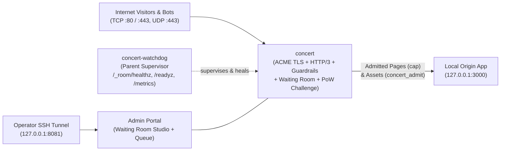

# Tutorial 01: Single-Host Linux VPS with ACME, `concert-watchdog` & Host-Protection Guardrails

Deploy Concert (`concert`) directly on a Linux VPS with automatic Let's Encrypt HTTPS, HTTP/3 (QUIC), systemd confinement, `concert-watchdog` supervision, and Lemmings-hardened host-protection guardrails (`-max-queue-per-ip`, `-allow-max-queue-per-ip`, `-host-max-mem-mb`, `-challenge-mode pow`).

---

## Topology



---

## Prerequisites

- **OS:** Linux x86_64 or arm64 — either RHEL / Rocky / Alma / CentOS Stream / Fedora (`installer.sh` with SELinux enforcing) or Debian / Ubuntu (manual systemd unit below).
- **Network:** Public IPv4/IPv6 with DNS `A`/`AAAA` record pointing `$DOMAIN` to this VPS; ports `80/tcp`, `443/tcp`, and `443/udp` open in firewall/security groups.
- **Origin:** An HTTP application listening on `127.0.0.1:3000` (with a lightweight `GET /healthz` endpoint returning `200 OK`).
- **Tools:** `curl`, `openssl`, `jq`, `tar`, `sha256sum` (or `shasum`), and root/`sudo` privileges.
- **Binaries:** Build locally (`make build`) or download `concert` and `concert-watchdog` release tarballs from GitHub Releases and verify against `SHA256SUMS.txt`.

Set shell variables for this session:

```bash
export DOMAIN="app.example.com"
export TLS_EMAIL="ops@example.com"
export ORIGIN="http://127.0.0.1:3000"
export CONCERT_VERSION="v0.3.0"
export ARCH="amd64"   # or arm64
```

---

## Step 1: Provision `0600` Secrets (`*_FILE` — Zero Hardcoded Secrets)

Create the configuration, data, and secrets directories with strict ownership (`concert:concert` or root-owned readable only by the service user):

```bash
sudo groupadd --system concert 2>/dev/null || true
sudo useradd --system --gid concert --home-dir /var/lib/concert --shell /usr/sbin/nologin concert 2>/dev/null || true

sudo install -d -m 0750 -o root -g concert /etc/concert /etc/concert/secrets
sudo install -d -m 0700 -o concert -g concert /var/lib/concert /var/lib/concert/data /var/lib/concert/acme /var/lib/concert/naddr

# Generate high-entropy secrets directly into 0600 files (never echoed to terminal or argv)
sudo sh -c 'umask 077 && openssl rand -base64 48 > /etc/concert/secrets/admit_secret'
sudo sh -c 'umask 077 && openssl rand -hex 32 > /etc/concert/secrets/admin_token'
sudo sh -c 'umask 077 && openssl rand -hex 24 > /etc/concert/secrets/portal_pass'

sudo chown root:concert /etc/concert/secrets/*
sudo chmod 0640 /etc/concert/secrets/*
```

> **Note:** On `installer.sh` (RHEL-family), `CONCERT_WATCHDOG_TOKEN_FILE` can point to `/etc/concert/secrets/admin_token` (or a dedicated `operator`-role token) so `concert-watchdog` can call `POST /_room/queue/clear` cleanly if the queue stalls.

---

## Step 2A: Automated Install on RHEL / Rocky / Alma / Fedora (`installer.sh` + `CONCERT_WATCHDOG=1`)

If you are on RHEL, Rocky Linux, AlmaLinux, CentOS Stream, or Fedora, `installer.sh` installs both `concert` and `concert-watchdog`, compiles and loads the SELinux enforcing policy, downloads the IPtoASN database, and configures the systemd service:

```bash
# Place verified Linux binaries in staging path (or set CONCERT_BINARY / CONCERT_WATCHDOG_BINARY)
sudo install -m 0755 ./bin/concert-linux-${ARCH} /tmp/concert-linux-${ARCH}
sudo install -m 0755 ./bin/concert-watchdog-linux-${ARCH} /tmp/concert-watchdog-linux-${ARCH}

CONCERT_SHA="$(sha256sum /tmp/concert-linux-${ARCH} | awk '{print $1}')"
WATCHDOG_SHA="$(sha256sum /tmp/concert-watchdog-linux-${ARCH} | awk '{print $1}')"

sudo \
  CONCERT_BINARY="/tmp/concert-linux-${ARCH}" \
  CONCERT_SHA256="${CONCERT_SHA}" \
  CONCERT_WATCHDOG=1 \
  CONCERT_WATCHDOG_BINARY="/tmp/concert-watchdog-linux-${ARCH}" \
  CONCERT_WATCHDOG_SHA256="${WATCHDOG_SHA}" \
  CONCERT_WATCHDOG_MAX_RSS_MB=768 \
  CONCERT_WATCHDOG_MAX_FDS=32768 \
  CONCERT_WATCHDOG_FAIL_THRESHOLD=3 \
  CONCERT_WATCHDOG_MAX_RESTARTS=5 \
  CONCERT_WATCHDOG_RESTART_WINDOW=15m \
  CONCERT_ALLOW_LOW_PORTS=1 \
  bash ./installer.sh
```

After `installer.sh` finishes, configure `/etc/concert/concert.env` and `/etc/concert/watchdog.env` as shown in Steps 3–4, then restart with `sudo systemctl restart concert`.

---

## Step 2B: Manual Install on Debian / Ubuntu (or Any systemd Linux)

Install verified binaries into `/usr/local/bin/`:

```bash
sudo install -m 0755 ./bin/concert-linux-${ARCH} /usr/local/bin/concert
sudo install -m 0755 ./bin/concert-watchdog-linux-${ARCH} /usr/local/bin/concert-watchdog

# Download IPtoASN database atomically for Admin Portal country flags & ASN badges
sudo curl -fsSL -o /var/lib/concert/naddr/.new https://iptoasn.com/data/ip2asn-combined.tsv.gz
sudo gzip -t /var/lib/concert/naddr/.new
sudo mv /var/lib/concert/naddr/.new /var/lib/concert/naddr/ip2asn-combined.tsv.gz
sudo chown concert:concert /var/lib/concert/naddr/ip2asn-combined.tsv.gz
```

---

## Step 3: Write `Concertfile` and Environment Files

Create `/etc/concert/Concertfile`:

```text
{
    listen :443
    http_listen :80
    tls_email ops@example.com
    tls_cache /var/lib/concert/acme
    hsts_max_age 31536000
    http3 on
    data_dir /var/lib/concert/data
    portal_listen 127.0.0.1:8081
    portal_allow 127.0.0.1/32 ::1/128

    ready_grace 30s
    idle_poll_ttl 45s
    reaper 10s
    retry_after 5
    upstream_timeout 60s
    upstream_body_idle_timeout 30s
    upstream_cb_failures 5
    upstream_cb_cooldown 15s
    upstream_health_path /healthz
    upstream_health_interval 10s
}

app.example.com {
    upstream http://127.0.0.1:3000
    cap 40
    priority_cap 10
    max_queue 1000
    secure_cookie on
    assets /css/* /js/* /images/* /fonts/*
    asset_public /og-image.png
    bypass /favicon.ico /robots.txt
    ban_paths /.env /.git/* /.aws/* /phpmyadmin/* /wp-config.php.bak
}
```

> Replace `app.example.com` and `ops@example.com` with your real `$DOMAIN` and `$TLS_EMAIL`.

Create `/etc/concert/concert.env` (`0640 root:concert`) containing the `*_FILE` secret paths and Lemmings host-protection guardrails:

```ini
# Declarative config + IP database
CONCERT_CONFIG=/etc/concert/Concertfile
NADDR_DATA=/var/lib/concert/naddr/ip2asn-combined.tsv.gz
NADDR_DATA_POLL=5m

# File-backed secrets (never hardcoded in argv or Concertfile)
CONCERT_ADMIT_SECRET_FILE=/etc/concert/secrets/admit_secret
CONCERT_ADMIN_TOKEN_FILE=/etc/concert/secrets/admin_token
CONCERT_PORTAL_PASS_FILE=/etc/concert/secrets/portal_pass

# Host-protection guardrails (protect both origin and the Concert VPS itself)
CONCERT_MAX_QUEUE_PER_IP=4
CONCERT_ALLOW_MAX_QUEUE_PER_IP=24
CONCERT_HOST_MAX_MEM_MB=768
CONCERT_HOST_MAX_FDS=32768
CONCERT_HOST_MAX_CONNS=20000
CONCERT_CHALLENGE_MODE=pow
CONCERT_CHALLENGE_POW_BITS=16
CONCERT_ADMIT_SESSION_CONTINUITY=true
CONCERT_STATS_AUTH=true
```

Create `/etc/concert/watchdog.env` (`0640 root:concert`) so `concert-watchdog` reads its bearer token strictly from disk:

```ini
CONCERT_WATCHDOG_TOKEN_FILE=/etc/concert/secrets/admin_token
```

> **Guardrail explanation:**
> - `-max-queue-per-ip=4` (`CONCERT_MAX_QUEUE_PER_IP=4`): limits any single untrusted IP (or IPv6 `/64`) to at most 4 queued waiting-room tickets so one flood source cannot fill `-max-queue`.
> - `-allow-max-queue-per-ip=24` (`CONCERT_ALLOW_MAX_QUEUE_PER_IP=24`): gives allowlisted office/CGNAT IPs (`-abuse-allow`) a higher quota while still bounding runaway scripts behind corporate NAT.
> - `-host-max-mem-mb=768` (`CONCERT_HOST_MAX_MEM_MB=768`): sheds new arrivals cleanly with `503` + `Retry-After` before the Linux OOM killer can terminate Concert.
> - `-challenge-mode=pow` (`CONCERT_CHALLENGE_MODE=pow`): requires a zero-dependency SHA-256 Proof-of-Work challenge (`-challenge-pow-bits=16`) before minting a waiting-room ticket, stopping headless curl floods with zero third-party SaaS dependency.

---

## Step 4: Configure the `systemd` Service Supervised by `concert-watchdog`

Write `/etc/systemd/system/concert.service` (if not already generated by `installer.sh`):

```ini
[Unit]
Description=Concert Waiting Room Proxy (supervised by concert-watchdog)
After=network-online.target
Wants=network-online.target

[Service]
Type=simple
User=concert
Group=concert
EnvironmentFile=/etc/concert/concert.env
EnvironmentFile=-/etc/concert/watchdog.env
ExecStart=/usr/local/bin/concert-watchdog \
  -health-url https://127.0.0.1:443/_room/healthz \
  -ready-url https://127.0.0.1:443/_room/readyz \
  -metrics-url https://127.0.0.1:443/_room/metrics \
  -clear-url https://127.0.0.1:443/_room/queue/clear \
  -interval 10s \
  -timeout 3s \
  -max-rss-mb 768 \
  -max-fds 32768 \
  -max-5xx-ratio 0.5 \
  -fail-threshold 3 \
  -max-restarts 5 \
  -restart-window 15m \
  -drain-timeout 30s \
  -- /usr/local/bin/concert -config /etc/concert/Concertfile
ExecReload=/bin/kill -HUP $MAINPID
Restart=on-failure
RestartSec=5s
TimeoutStopSec=45s
LimitNOFILE=65536
AmbientCapabilities=CAP_NET_BIND_SERVICE
CapabilityBoundingSet=CAP_NET_BIND_SERVICE
NoNewPrivileges=yes
ProtectSystem=strict
ProtectHome=yes
PrivateTmp=yes
ReadWritePaths=/var/lib/concert

[Install]
WantedBy=multi-user.target
```

> **Note:** When `-listen :443` terminates TLS with ACME for `$DOMAIN`, point `concert-watchdog`'s probe URLs to `https://${DOMAIN}/_room/...` (with `/etc/hosts` resolving `$DOMAIN` to `127.0.0.1`) so TLS SNI matches the ACME certificate cleanly.

Enable and start the service:

```bash
sudo systemctl daemon-reload
sudo systemctl enable --now concert.service
sudo systemctl status concert.service --no-pager
```

---

## Step 5: Verification Commands & Expected Outputs

Run every check below (automated agents should assert exit code `0` on each step):

```bash
TOKEN="$(sudo cat /etc/concert/secrets/admin_token)"

# 1. Verify liveness and readiness over HTTPS
curl -fsS "https://${DOMAIN}/_room/healthz"
# Expected: ok

curl -fsS "https://${DOMAIN}/_room/readyz"
# Expected: ok

# 2. Verify HTTP -> HTTPS redirect and HSTS + Alt-Svc (HTTP/3) headers
curl -sSI "http://${DOMAIN}/" | grep -iE '^(HTTP/|location:)'
# Expected: HTTP/1.1 301 Moved Permanently (or 308) and Location: https://app.example.com/

curl -sSI "https://${DOMAIN}/" | grep -iE '^(HTTP/|strict-transport-security:|alt-svc:)'
# Expected: HTTP/2 200, strict-transport-security: max-age=31536000, alt-svc: h3=":443"

# 3. Verify authenticated Prometheus metrics and guardrail counters
curl -fsS -H "Authorization: Bearer ${TOKEN}" "https://${DOMAIN}/_room/metrics" \
  | grep -E '^(concert_ready|concert_room_cap|concert_guard_)'
# Expected:
# concert_ready 1
# concert_room_cap 40
# concert_guard_quota_rejected_total 0
# concert_guard_shed_total 0
# concert_guard_challenge_passed_total 0

# 4. Verify watchdog supervision logs (no restart loops, healthy probes)
sudo journalctl -u concert.service -n 25 --no-pager | grep -E 'starting concert-watchdog|concert'
# Expected: mode=parent-supervisor, operator_token_configured=true, zero restart-breaker alerts

# 5. Access the Admin Portal safely via SSH tunnel from your workstation
# ssh -L 8081:127.0.0.1:8081 ops@${DOMAIN}
# Then open http://127.0.0.1:8081/ and sign in with the value in /etc/concert/secrets/portal_pass
```

---

## Troubleshooting & Rollback

| Symptom | Diagnosis | Fix |
| --- | --- | --- |
| ACME certificate issuance fails on startup | Port `80/tcp` blocked or DNS A/AAAA mismatch | Verify `dig +short "$DOMAIN"` matches the VPS IP and `ss -tlnp \| grep ':80'`; test first with `tls_staging on` in `Concertfile`. |
| Watchdog logs TLS name mismatch probing `127.0.0.1:443` | ACME cert SAN is `$DOMAIN`, not `127.0.0.1` | Add `127.0.0.1 ${DOMAIN}` to `/etc/hosts` and use `https://${DOMAIN}/_room/healthz` in `concert.service`. |
| Origin is down, does watchdog restart Concert needlessly? | Check `journalctl -u concert.service` | No — `concert-watchdog` inspects `concert_upstream_backends_healthy` from `/_room/metrics` and **suppresses** Concert restarts when the upstream origin itself is the fault. Fix the origin on `127.0.0.1:3000`. |
| Legitimate corporate office hits `-max-queue-per-ip` | Shared NAT exceeds 4 concurrent queued browsers | Add the office CIDR to `CONCERT_ABUSE_ALLOW` so it receives `CONCERT_ALLOW_MAX_QUEUE_PER_IP=24`. |

### Rollback Procedure

```bash
# 1. Stop Concert and restore previous reverse proxy (if migrating from nginx/caddy)
sudo systemctl stop concert.service
sudo systemctl disable concert.service

# 2. If upgrading a binary caused a regression, swap back the prior verified binary and restart:
# sudo install -m 0755 /usr/local/bin/concert.prev /usr/local/bin/concert
# sudo systemctl start concert.service

# 3. Emergency empty-queue start (one-shot only, then remove env var):
# sudo systemctl set-environment CONCERT_CLEAR_QUEUE_ON_START=true
# sudo systemctl restart concert.service
# sudo systemctl unset-environment CONCERT_CLEAR_QUEUE_ON_START
```
