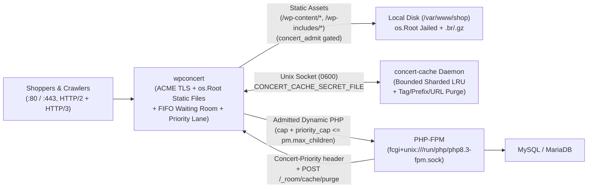

# Tutorial 02: WordPress & WooCommerce Stack (`wpconcert` + PHP-FPM + `concert-cache` + WordPress Plugin)

Replace Nginx/Caddy/Apache entirely with **`wpconcert`** speaking native FastCGI (`fcgi+unix://`) to PHP-FPM, backed by an isolated **`concert-cache`** page-cache daemon and the official **`clients/wordpress`** plugin for automatic `Concert-Priority` ranking and instant cache purging on post/product/stock updates.

---

## Topology



---

## Prerequisites

- **OS:** Linux host running PHP-FPM (`php8.3-fpm` or `php-fpm`) with an existing WordPress + WooCommerce install in `/var/www/shop`.
- **Binaries:** `wpconcert` (`go build -tags wordpress ./cmd/wpconcert`), `concert-cache` (`go build ./cmd/concert-cache`), and optionally `concert-watchdog`.
- **Plugin:** [`clients/wordpress/`](../../clients/wordpress/) from this repository.
- **Sizing Rule:** Always ensure `cap + priority_cap <= pm.max_children` in your PHP-FPM pool (for example, `pm.max_children = 16` → `cap 12`, `priority_cap 4`).

Set session variables:

```bash
export DOMAIN="shop.example.com"
export TLS_EMAIL="ops@example.com"
export WP_ROOT="/var/www/shop"
export FPM_SOCK="/run/php/php8.3-fpm.sock"
export FPM_GROUP="www-data"   # use "apache" on RHEL/Rocky/Alma
export ARCH="amd64"
```

---

## Step 1: Install Binaries & Provision `0600` Secrets (`*_FILE`)

```bash
sudo groupadd --system concert 2>/dev/null || true
sudo useradd --system --gid concert --groups "${FPM_GROUP}" --home-dir /var/lib/concert --shell /usr/sbin/nologin concert 2>/dev/null || true

sudo install -m 0755 ./bin/wpconcert-linux-${ARCH} /usr/local/bin/wpconcert
sudo install -m 0755 ./bin/concert-cache-linux-${ARCH} /usr/local/bin/concert-cache

sudo install -d -m 0750 -o root -g concert /etc/concert /etc/concert/secrets
sudo install -d -m 0700 -o concert -g concert /var/lib/concert /var/lib/concert/data /var/lib/concert/acme /run/concert-cache

sudo sh -c 'umask 077 && openssl rand -base64 48 > /etc/concert/secrets/admit_secret'
sudo sh -c 'umask 077 && openssl rand -hex 32 > /etc/concert/secrets/admin_token'
sudo sh -c 'umask 077 && openssl rand -hex 24 > /etc/concert/secrets/portal_pass'
sudo sh -c 'umask 077 && openssl rand -hex 32 > /etc/concert/secrets/cache_secret'

sudo chown root:concert /etc/concert/secrets/*
sudo chmod 0640 /etc/concert/secrets/*
```

Ensure the PHP-FPM pool socket allows group access (`listen.mode = 0660`, `listen.group = www-data` or `apache`) in `/etc/php/8.3/fpm/pool.d/www.conf`, and verify `pm.max_children`:

```bash
grep -E '^(pm|pm\.max_children|listen(\.mode|\.group)?)' /etc/php/8.3/fpm/pool.d/www.conf
```

---

## Step 2: Run `wpconcert init` & `wpconcert doctor`

Generate a baseline `Concertfile` sized automatically to your PHP-FPM pool, then inspect it with `doctor`:

```bash
sudo wpconcert init \
  --domain "${DOMAIN}" \
  --root "${WP_ROOT}" \
  --tls-email "${TLS_EMAIL}" \
  --http3 \
  --out /etc/concert/Concertfile

sudo wpconcert doctor --config /etc/concert/Concertfile
```

Refine `/etc/concert/Concertfile` to enable `micro_cache` (backed by external `concert-cache`), strict timeouts for slow WooCommerce checkouts, and `preset wordpress`:

```text
{
    listen :443
    http_listen :80
    tls_email ops@example.com
    tls_cache /var/lib/concert/acme
    hsts_max_age 31536000
    http3 on
    data_dir /var/lib/concert/data
    portal_listen 127.0.0.1:8081
    portal_allow 127.0.0.1/32 ::1/128

    ready_grace 30s
    idle_poll_ttl 45s
    reaper 10s
    upstream_timeout 90s
    upstream_body_idle_timeout 30s
    upstream_cb_failures 5
    upstream_cb_cooldown 15s
}

shop.example.com, www.shop.example.com {
    preset wordpress
    root /var/www/shop
    upstream fcgi+unix:///run/php/php8.3-fpm.sock
    cap 12
    priority_cap 4
    priority_lane_rank 3
    max_queue 500
    micro_cache 30s
    secure_cookie on
    bypass /wc-api/* /wp-cron.php
    ban_paths /xmlrpc.php /.env /.git/* /wp-config.php.bak
}
```

> **Security invariant:** `preset wordpress` automatically blocks PHP execution under `/wp-content/uploads/*` and `/wp-config.php`, gates `/wp-content/*` and `/wp-includes/*` behind `concert_admit`, and strictly bypasses the anonymous page cache whenever `wordpress_logged_in_*` or `woocommerce_*` cookies are present or on `POST` / `/checkout` / `/cart`.

---

## Step 3: Start the Dedicated `concert-cache` Daemon

Running `concert-cache` as a separate process isolates page-cache memory and blast radius from `wpconcert` and survives `wpconcert` restarts cleanly.

Create `/etc/systemd/system/concert-cache.service`:

```ini
[Unit]
Description=Concert Page Cache Daemon (concert-cache)
After=network.target

[Service]
Type=simple
User=concert
Group=concert
RuntimeDirectory=concert-cache
RuntimeDirectoryMode=0750
Environment=CONCERT_CACHE_SECRET_FILE=/etc/concert/secrets/cache_secret
ExecStart=/usr/local/bin/concert-cache \
  -unix /run/concert-cache/cache.sock \
  -metrics-listen 127.0.0.1:9390 \
  -max-bytes 268435456 \
  -shards 64 \
  -max-conns 4096
Restart=on-failure
RestartSec=2s
NoNewPrivileges=yes
ProtectSystem=strict
PrivateTmp=yes

[Install]
WantedBy=multi-user.target
```

Enable and start `concert-cache`:

```bash
sudo systemctl daemon-reload
sudo systemctl enable --now concert-cache.service
curl -fsS http://127.0.0.1:9390/_cache/healthz
# Expected: ok
```

---

## Step 4: Configure & Start `wpconcert` Connected to `concert-cache`

Create `/etc/concert/wpconcert.env` (`0640 root:concert`):

```ini
CONCERT_CONFIG=/etc/concert/Concertfile
CONCERT_ADMIT_SECRET_FILE=/etc/concert/secrets/admit_secret
CONCERT_ADMIN_TOKEN_FILE=/etc/concert/secrets/admin_token
CONCERT_PORTAL_PASS_FILE=/etc/concert/secrets/portal_pass
CONCERT_CACHE_ADDR=/run/concert-cache/cache.sock
CONCERT_CACHE_SECRET_FILE=/etc/concert/secrets/cache_secret
CONCERT_MAX_QUEUE_PER_IP=4
CONCERT_HOST_MAX_MEM_MB=1024
CONCERT_ADMIT_SESSION_CONTINUITY=true
CONCERT_STATS_AUTH=true
```

Create `/etc/systemd/system/wpconcert.service`:

```ini
[Unit]
Description=wpconcert Direct FastCGI Waiting Room Proxy
After=network-online.target php8.3-fpm.service concert-cache.service
Wants=network-online.target concert-cache.service

[Service]
Type=simple
User=concert
Group=concert
SupplementaryGroups=www-data
EnvironmentFile=/etc/concert/wpconcert.env
ExecStart=/usr/local/bin/wpconcert -config /etc/concert/Concertfile
ExecReload=/bin/kill -HUP $MAINPID
Restart=on-failure
RestartSec=3s
LimitNOFILE=65536
AmbientCapabilities=CAP_NET_BIND_SERVICE
CapabilityBoundingSet=CAP_NET_BIND_SERVICE
NoNewPrivileges=yes
ProtectSystem=strict
PrivateTmp=yes
ReadWritePaths=/var/lib/concert /run/concert-cache

[Install]
WantedBy=multi-user.target
```

Start `wpconcert`:

```bash
sudo systemctl daemon-reload
sudo systemctl enable --now wpconcert.service
```

---

## Step 5: Install & Configure the Official `clients/wordpress` Plugin

Install the plugin from [`clients/wordpress/src/`](../../clients/wordpress/src/) into WordPress:

```bash
sudo mkdir -p "${WP_ROOT}/wp-content/plugins/concert-wp"
sudo cp -R ./clients/wordpress/src/* "${WP_ROOT}/wp-content/plugins/concert-wp/"
sudo chown -R "${FPM_GROUP}:${FPM_GROUP}" "${WP_ROOT}/wp-content/plugins/concert-wp"
```

Provide the Concert endpoint and operator bearer token to PHP via a root-protected environment or `wp-config.php` file read (never hardcode secrets in tracked PHP files or WordPress DB options):

```bash
# Store a dedicated copy readable only by PHP-FPM (0600 www-data:www-data)
sudo install -m 0600 -o "${FPM_GROUP}" -g "${FPM_GROUP}" \
  /etc/concert/secrets/admin_token /etc/concert/secrets/wp_admin_token
```

In `/etc/php/8.3/fpm/pool.d/www.conf` (or read from file in `wp-config.php` before `wp-settings.php`):

```php
// wp-config.php — read secret strictly from 0600 file on disk (never hardcode)
if (!defined('CONCERT_ADMIN_URL')) {
    define('CONCERT_ADMIN_URL', 'https://shop.example.com');
}
if (!defined('CONCERT_ADMIN_TOKEN')) {
    $tokenPath = '/etc/concert/secrets/wp_admin_token';
    if (is_readable($tokenPath)) {
        define('CONCERT_ADMIN_TOKEN', trim((string) file_get_contents($tokenPath)));
    }
}
```

Activate the plugin (via WP-CLI or WP Admin → Plugins):

```bash
sudo -u "${FPM_GROUP}" wp plugin activate concert-wp --path="${WP_ROOT}"
```

What the plugin does automatically:
1. Emits `Concert-Priority` on every page response (`staff`, `checkout`, `subscriber`, `customer`, `prospect`, `member`). Concert signs it into an HttpOnly `concert_priority` cookie and strips the raw header before it reaches the browser.
2. Calls `POST /_room/cache/purge` (`{"mode":"url"|"prefix"|"tag"|"all","host":"shop.example.com","target":"..."}`) whenever a post is saved (`save_post`), a WooCommerce product updates (`woocommerce_update_product`), stock changes (`woocommerce_product_set_stock`), or an admin clicks **Purge Concert Cache** in the WP Admin Bar.

---

## Step 6: Verification Commands & Expected Outputs

```bash
TOKEN="$(sudo cat /etc/concert/secrets/admin_token)"

# 1. Verify wpconcert health and FastCGI/cache wiring
curl -fsS "https://${DOMAIN}/_room/healthz" && echo
# Expected: ok

# 2. Verify anonymous GET page caching via concert-cache (second fetch served in <5ms)
curl -fsS -o /dev/null -w "hit1=%{http_code} t=%{time_total}s\n" "https://${DOMAIN}/"
curl -fsS -o /dev/null -w "hit2=%{http_code} t=%{time_total}s\n" "https://${DOMAIN}/"
curl -fsS http://127.0.0.1:9390/_cache/metrics | grep -E '^concert_cache_(hits|misses|entries)'
# Expected: concert_cache_hits_total >= 1

# 3. Verify uploads PHP execution is hard-blocked with 403 (zero PHP-FPM load)
curl -sS -o /dev/null -w "%{http_code}\n" "https://${DOMAIN}/wp-content/uploads/probe.php"
# Expected: 403

# 4. Verify active cache purge API (operator token required)
curl -fsS -X POST "https://${DOMAIN}/_room/cache/purge" \
  -H "Authorization: Bearer ${TOKEN}" \
  -H "Content-Type: application/json" \
  -d "{\"mode\":\"prefix\",\"host\":\"${DOMAIN}\",\"target\":\"/product/\"}"
# Expected: {"mode":"prefix","purged":...}

# 5. Verify Concert-Priority header is stripped from public responses (converted to signed cookie)
curl -sSI "https://${DOMAIN}/checkout/" | grep -i '^concert-priority:' || echo "header stripped cleanly"
# Expected: header stripped cleanly
```

---

## Troubleshooting & Rollback

| Symptom | Diagnosis | Fix |
| --- | --- | --- |
| `502 Bad Gateway` on PHP routes | `wpconcert` cannot connect to PHP-FPM Unix socket | Verify `id concert` includes `www-data`/`apache` and `ls -l $FPM_SOCK` is `srw-rw----`. |
| `404` on `POST /_room/cache/purge` | `micro_cache` is `0s` or `CONCERT_CACHE_ADDR` unset | Ensure `micro_cache 30s` is set on the site block in `Concertfile` and `CONCERT_CACHE_ADDR` + `CONCERT_CACHE_SECRET_FILE` are set. |
| Logged-in admin sees cached homepage | Plugin or custom theme strips `wordpress_logged_in_*` cookie | Verify `preset wordpress` is enabled; `wpconcert` automatically bypasses cache when `wordpress_logged_in_*` or `woocommerce_*` cookies are present. |
| `concert-cache` unavailable during traffic | Check `systemctl status concert-cache` | `wpconcert` degrades safely without serving stale cross-user data; restart `concert-cache.service` or remove `CONCERT_CACHE_ADDR` to fall back immediately to built-in in-process `micro_cache`. |

### Rollback Procedure

```bash
# Fall back to in-process micro-cache without stopping WordPress traffic:
# Remove CONCERT_CACHE_ADDR from /etc/concert/wpconcert.env and run:
sudo systemctl restart wpconcert.service

# Or deactivate the WordPress plugin cleanly:
sudo -u "${FPM_GROUP}" wp plugin deactivate concert-wp --path="${WP_ROOT}"
```
