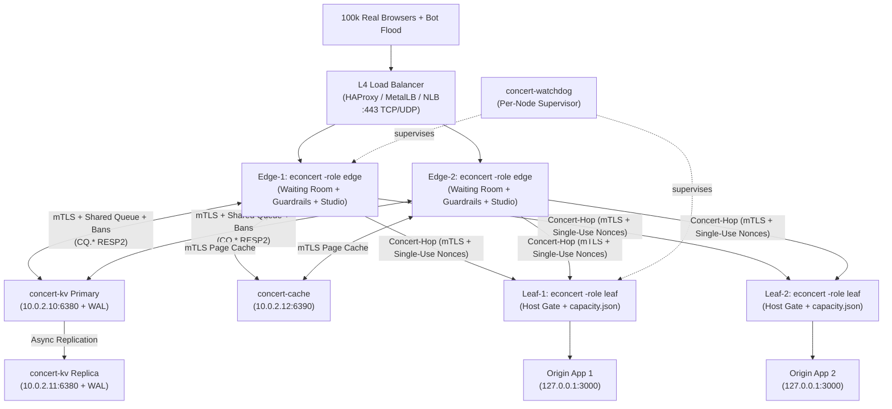

# Tutorial 03: High-Traffic 100k-Connection Edge/Leaf Mesh (`econcert` + `concert-kv` HA + `concert-cache` + `bench-concert`)

Deploy a multi-node, horizontally scalable **100k-connection** Concert mesh using **`econcert`** in two-tier Edge/Leaf mode, backed by primary/replica **`concert-kv`** HA (zero Redis dependency), shared **`concert-cache`**, **`concert-watchdog`** supervision, an L4 load balancer, and end-to-end soak verification with `bench-concert -profile soak-100k -mix-real-and-flood`.

---

## Topology



---

## Prerequisites

- **Hosts (example private subnet `10.0.0.0/16`):**
  - 1x L4 Load Balancer (`lb.internal`, forwarding `:443` TCP/UDP to Edge-1 and Edge-2).
  - 2x Edge nodes (`10.0.1.10`, `10.0.1.11`) running `econcert -role edge` + `concert-watchdog`.
  - 2x Leaf nodes (`10.0.3.10`, `10.0.3.11`) co-located with origin apps on `127.0.0.1:3000`, running `econcert -role leaf`.
  - 2x `concert-kv` nodes (`10.0.2.10` primary, `10.0.2.11` replica).
  - 1x `concert-cache` node (`10.0.2.12`).
- **Internal PKI (mTLS):** A private CA (`/etc/concert/pki/ca.crt`) issuing node certs (`edge.crt`/`edge.key`, `leaf.crt`/`leaf.key`, `kv.crt`/`kv.key`, `cache.crt`/`cache.key`).
- **OS Tuning (Edge & Leaf hosts):** Raise file descriptor and socket limits so 100k concurrent sockets never exhaust kernel tables:

```bash
sudo tee /etc/sysctl.d/99-concert-100k.conf >/dev/null <<'EOF'
net.core.somaxconn = 65535
net.core.netdev_max_backlog = 65535
net.ipv4.ip_local_port_range = 10240 65535
net.ipv4.tcp_max_syn_backlog = 65535
net.ipv4.tcp_tw_reuse = 1
fs.file-max = 2097152
EOF
sudo sysctl --system
```

---

## Step 1: Provision Shared Cluster Secrets (`*_FILE`, `0600`)

Generate cluster secrets once on your secure bootstrap host and distribute them via your secrets manager (Vault / Ansible Vault / SOPS) into `/etc/concert/secrets/` (`0640 root:concert`) on the appropriate nodes:

```bash
mkdir -p ./cluster-secrets && chmod 0700 ./cluster-secrets
umask 077
openssl rand -base64 48 > ./cluster-secrets/admit_secret      # Edge + Leaf
openssl rand -base64 48 > ./cluster-secrets/hop_secret        # Edge + Leaf
openssl rand -hex 32    > ./cluster-secrets/kv_password       # KV Primary/Replica + Edge
openssl rand -hex 32    > ./cluster-secrets/cache_secret      # concert-cache + Edge
openssl rand -hex 32    > ./cluster-secrets/operator_token    # Edge + Leaf + Watchdog
openssl rand -hex 32    > ./cluster-secrets/viewer_token      # Prometheus scraper
openssl rand -hex 32    > ./cluster-secrets/admin_token       # Admin API

# Build scoped CONCERT_ADMIN_TOKENS file (never hardcode in manifests)
printf 'prometheus:viewer:%s,watchdog:operator:%s,ops:admin:%s\n' \
  "$(cat ./cluster-secrets/viewer_token)" \
  "$(cat ./cluster-secrets/operator_token)" \
  "$(cat ./cluster-secrets/admin_token)" > ./cluster-secrets/admin_tokens
```

Generate Portal RBAC users with Argon2id hashes (`econcert hash-password`):

```bash
HASH="$(econcert hash-password)"
printf '[{"username":"ops@example.com","password_hash":"%s","role":"admin"}]\n' "$HASH" \
  > ./cluster-secrets/portal_users.json
chmod 0600 ./cluster-secrets/portal_users.json
```

---

## Step 2: Deploy `concert-kv` Primary & Replica HA (Zero Redis)

On **KV Primary (`10.0.2.10`)**:

```ini
# /etc/systemd/system/concert-kv.service
[Unit]
Description=Concert KV Primary (Pure-Stdlib RESP2)
After=network-online.target

[Service]
Type=simple
User=concert
Group=concert
Environment=CONCERT_KV_PASSWORD_FILE=/etc/concert/secrets/kv_password
ExecStart=/usr/local/bin/concert-kv \
  -listen 10.0.2.10:6380 \
  -tls-cert /etc/concert/pki/kv.crt \
  -tls-key /etc/concert/pki/kv.key \
  -tls-client-ca /etc/concert/pki/ca.crt \
  -data-dir /var/lib/concert-kv \
  -max-memory 512MiB \
  -max-conns 4096
Restart=on-failure
LimitNOFILE=65536
NoNewPrivileges=yes

[Install]
WantedBy=multi-user.target
```

On **KV Replica (`10.0.2.11`)**, add `-replica-of 10.0.2.10:6380` to `ExecStart` (with the same `CONCERT_KV_PASSWORD_FILE` and mTLS certs):

```bash
/usr/local/bin/concert-kv \
  -listen 10.0.2.11:6380 \
  -replica-of 10.0.2.10:6380 \
  -tls-cert /etc/concert/pki/kv.crt \
  -tls-key /etc/concert/pki/kv.key \
  -tls-client-ca /etc/concert/pki/ca.crt \
  -data-dir /var/lib/concert-kv \
  -max-memory 512MiB \
  -max-conns 4096
```

---

## Step 3: Deploy Shared `concert-cache` (`10.0.2.12`)

```ini
# /etc/systemd/system/concert-cache.service
[Unit]
Description=Concert Shared Page Cache Daemon
After=network-online.target

[Service]
Type=simple
User=concert
Group=concert
Environment=CONCERT_CACHE_SECRET_FILE=/etc/concert/secrets/cache_secret
ExecStart=/usr/local/bin/concert-cache \
  -listen 10.0.2.12:6390 \
  -metrics-listen 127.0.0.1:9390 \
  -tls-cert /etc/concert/pki/cache.crt \
  -tls-key /etc/concert/pki/cache.key \
  -tls-client-ca /etc/concert/pki/ca.crt \
  -max-bytes 1073741824 \
  -shards 128 \
  -max-conns 8192
Restart=on-failure
LimitNOFILE=65536
NoNewPrivileges=yes

[Install]
WantedBy=multi-user.target
```

---

## Step 4: Deploy Leaf Nodes (`econcert -role leaf`)

On each Leaf host (`10.0.3.10` as `leaf-1`, `10.0.3.11` as `leaf-2`), first measure origin capacity once with `bench-concert` (or enable `-bench-on-start=true`):

```bash
sudo -u concert /usr/local/bin/bench-concert \
  -target http://127.0.0.1:3000/ \
  -data-dir /var/lib/concert/data \
  -out /var/lib/concert/data/bench-report.json
```

Create `/etc/concert/leaf.env` (`0640 root:concert`):

```ini
CONCERT_ROLE=leaf
CONCERT_NODE_ID=leaf-1
CONCERT_LISTEN=:8443
CONCERT_UPSTREAM=http://127.0.0.1:3000
CONCERT_UPSTREAM_HEALTH_PATH=/healthz
CONCERT_UPSTREAM_CB_FAILURES=5
CONCERT_UPSTREAM_CB_COOLDOWN=15s
CONCERT_UPSTREAM_BODY_IDLE_TIMEOUT=30s

# Hardened mTLS + single-use Concert-Hop nonce enforcement
CONCERT_HARDENED=true
CONCERT_STATS_AUTH=true
CONCERT_SECURE_COOKIE=true
CONCERT_TLS_CLIENT_CA=/etc/concert/pki/ca.crt
CONCERT_HOP_PEERS=10.0.1.0/24
CONCERT_HOP_REQUIRE_MTLS=true
CONCERT_HOP_REQUIRE_NONCE=true
CONCERT_HOP_REPLAY_GUARD=true

# Portal & persistence (pass PEM cert/key paths via CLI flags below)
CONCERT_PORTAL_LISTEN=127.0.0.1:8081
CONCERT_PORTAL_SECURE_COOKIE=true
CONCERT_DATA_DIR=/var/lib/concert/data
CONCERT_LOG_FORMAT=json

# File-backed secrets
CONCERT_ADMIT_SECRET_FILE=/etc/concert/secrets/admit_secret
CONCERT_HOP_SECRET_FILE=/etc/concert/secrets/hop_secret
CONCERT_ADMIN_TOKENS_FILE=/etc/concert/secrets/admin_tokens
CONCERT_PORTAL_USERS_FILE=/etc/concert/secrets/portal_users.json
```

Start each Leaf under systemd with `EnvironmentFile=/etc/concert/leaf.env` and PEM paths passed as flags:

```bash
/usr/local/bin/econcert \
  -tls-cert /etc/concert/pki/leaf.crt \
  -tls-key /etc/concert/pki/leaf.key \
  -portal-tls-cert /etc/concert/pki/leaf.crt \
  -portal-tls-key /etc/concert/pki/leaf.key
```

---

## Step 5: Deploy Edge Nodes (`econcert -role edge` + `concert-watchdog`)

On each Edge host (`10.0.1.10` as `edge-1`, `10.0.1.11` as `edge-2`), create `/etc/concert/edge.env` (`0640 root:concert`):

```ini
CONCERT_ROLE=edge
CONCERT_NODE_ID=edge-1
CONCERT_LISTEN=:443
CONCERT_TLS_HTTP_LISTEN=:80
CONCERT_TLS_DOMAINS=launch.example.com
CONCERT_TLS_EMAIL=ops@example.com
CONCERT_TLS_CACHE=/var/lib/concert/acme
CONCERT_HSTS_MAX_AGE=31536000
CONCERT_HTTP3=true

# Leaf mesh (mTLS upstream + automatic leaf capacity sizing; pass client cert/key paths via CLI flags)
CONCERT_UPSTREAM=https://10.0.3.10:8443,https://10.0.3.11:8443
CONCERT_HOP_LEAVES=https://10.0.3.10:8443,https://10.0.3.11:8443
CONCERT_HOP_AUTO_CAP=true
CONCERT_HOP_POLL=5s
CONCERT_UPSTREAM_CA=/etc/concert/pki/ca.crt
CONCERT_UPSTREAM_RETRIES=1

# concert-kv HA + shared waiting-room queue + ban sync
CONCERT_KV_ADDR=10.0.2.10:6380
CONCERT_KV_TLS=true
CONCERT_KV_PREFIX=concert:prod
CONCERT_KV_SHARED_QUEUE=true
CONCERT_KV_PASSWORD_FILE=/etc/concert/secrets/kv_password

# Shared concert-cache
CONCERT_CACHE_ADDR=10.0.2.12:6390
CONCERT_CACHE_TLS=true
CONCERT_CACHE_SECRET_FILE=/etc/concert/secrets/cache_secret
CONCERT_MICRO_CACHE_TTL=15s

# Waiting room & 100k-connection host protection
CONCERT_CAPACITY=400
CONCERT_PRIORITY_CAP=80
CONCERT_MAX_QUEUE=100000
CONCERT_READY_GRACE=30s
CONCERT_IDLE_POLL_TTL=45s
CONCERT_REAPER=10s
CONCERT_MAX_QUEUE_PER_IP=4
CONCERT_ALLOW_MAX_QUEUE_PER_IP=32
CONCERT_HOST_MAX_MEM_MB=4096
CONCERT_HOST_MAX_FDS=200000
CONCERT_HOST_MAX_CONNS=120000
CONCERT_ADMIT_SESSION_CONTINUITY=true
CONCERT_TRUSTED_PROXIES=127.0.0.1/32,::1/128,10.0.0.0/16

# Enterprise hardened security
CONCERT_HARDENED=true
CONCERT_STATS_AUTH=true
CONCERT_SECURE_COOKIE=true
CONCERT_PORTAL_LISTEN=127.0.0.1:8081
CONCERT_PORTAL_SECURE_COOKIE=true
CONCERT_DATA_DIR=/var/lib/concert/data
CONCERT_LOG_FORMAT=json

# File-backed secrets
CONCERT_ADMIT_SECRET_FILE=/etc/concert/secrets/admit_secret
CONCERT_HOP_SECRET_FILE=/etc/concert/secrets/hop_secret
CONCERT_ADMIN_TOKENS_FILE=/etc/concert/secrets/admin_tokens
CONCERT_PORTAL_USERS_FILE=/etc/concert/secrets/portal_users.json
```

Supervise each Edge under systemd with `LimitNOFILE=262144`, `EnvironmentFile=/etc/concert/edge.env`, and `CONCERT_WATCHDOG_TOKEN_FILE=/etc/concert/secrets/operator_token`:

```bash
/usr/local/bin/concert-watchdog \
  -health-url https://launch.example.com/_room/healthz \
  -ready-url https://launch.example.com/_room/readyz \
  -metrics-url https://launch.example.com/_room/metrics \
  -clear-url https://launch.example.com/_room/queue/clear \
  -max-rss-mb 4096 \
  -max-fds 200000 \
  -- /usr/local/bin/econcert \
    -upstream-client-cert /etc/concert/pki/edge.crt \
    -upstream-client-key /etc/concert/pki/edge.key \
    -portal-tls-cert /etc/concert/pki/edge.crt \
    -portal-tls-key /etc/concert/pki/edge.key
```

### L4 Load Balancer Example (HAProxy TCP Pass-Through)

```haproxy
frontend concert_https_l4
    bind *:443
    mode tcp
    option tcplog
    default_backend concert_edges

backend concert_edges
    mode tcp
    balance leastconn
    option httpchk GET /_room/readyz
    http-check expect status 200
    server edge1 10.0.1.10:443 check check-ssl verify required ca-file /etc/concert/pki/ca.crt
    server edge2 10.0.1.11:443 check check-ssl verify required ca-file /etc/concert/pki/ca.crt
```

---

## Step 6: Run the 100k Mixed Real-Human + Flood Soak Verification

From a dedicated load-generator host (never the origin host), run `bench-concert` against staging/pre-launch using the built-in `soak-100k` profile with `-mix-real-and-flood`:

```bash
bench-concert \
  -target "https://launch.example.com/" \
  -profile soak-100k \
  -mix-real-and-flood \
  -soak-duration 5m \
  -soak-connections 100000 \
  -humans 200 \
  -flood 1000 \
  -max-requeues 0 \
  -max-human-5xx 0 \
  -p95 2s \
  -out ./soak-100k-report.json
```

### Expected Outputs & Verification Checks

```bash
VIEWER_TOKEN="$(sudo cat /etc/concert/secrets/viewer_token)"

# 1. bench-concert exits 0 with PASS verdict:
#    - Zero re-queues of already-admitted human sessions (concert_admit sliding continuity)
#    - Zero upstream 5xx on human sessions
#    - Flood cohort cleanly contained by per-IP queue quotas & abuse registry

# 2. Verify Edge leaf-mesh health & shared queue metrics
curl -fsS -H "Authorization: Bearer ${VIEWER_TOKEN}" "https://launch.example.com/_room/metrics" \
  | grep -E '^(concert_ready|concert_upstream_backends_healthy|concert_guard_quota_rejected_total|concert_room_rejected_503_total)'
# Expected:
# concert_ready 1
# concert_upstream_backends_healthy 2

# 3. Verify Leaf mTLS & replay protection counters
curl -fsS --cacert /etc/concert/pki/ca.crt \
  -H "Authorization: Bearer ${VIEWER_TOKEN}" \
  "https://10.0.3.10:8443/_room/metrics" \
  | grep -E '^concert_leaf_hop_'
# Expected: concert_leaf_hop_replayed_total 0, concert_leaf_hop_mtls_rejected_total 0
```

---

## Troubleshooting & Rollback

| Symptom | Diagnosis | Fix |
| --- | --- | --- |
| Edge `concert_ready 0` | Leaves unreachable or mTLS handshake rejected | Verify `CONCERT_HOP_PEERS` includes Edge CIDR, leaf cert SAN matches IP/host, and `CONCERT_HOP_SECRET_FILE` bytes match identically. |
| `concert-kv` primary fails | Edge logs KV reconnect errors | Promote Replica (`10.0.2.11`) by removing `-replica-of` and restarting it, or switch `CONCERT_KV_ADDR=10.0.2.11:6380`; edges remain up fail-open with local rooms during failover. |
| `bench-concert` reports `requeues > 0` | `CONCERT_ADMIT_SECRET_FILE` differs across edges | Verify `sha256sum /etc/concert/secrets/admit_secret` is identical on Edge-1 and Edge-2 so `concert_admit` cookies validate on both edges. |

### Rollback Procedure

```bash
# Drain a single Edge gracefully (marks /_room/readyz -> 503 immediately so L4 LB stops sending traffic):
sudo systemctl stop econcert-edge.service

# Re-benchmark a leaf live without downtime after changing origin hardware:
ADMIN_TOKEN="$(sudo cat /etc/concert/secrets/admin_token)"
curl -fsS -X POST "https://10.0.3.10:8443/_room/rebench" \
  --cacert /etc/concert/pki/ca.crt \
  -H "Authorization: Bearer ${ADMIN_TOKEN}"
```
