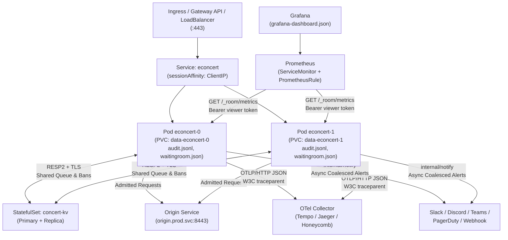

# Tutorial 04: Kubernetes Production Cluster (`StatefulSet` + `concert-kv` + Prometheus/Grafana + OTLP + ChatOps)

Deploy hardened **`econcert`** on Kubernetes as a `StatefulSet` with per-pod PVCs (so `audit.jsonl`, `waitingroom.json`, `bans.json`, and `queue.snapshot` survive pod restarts), backed by **`concert-kv`**, official Prometheus alert rules, Grafana dashboards, pure-stdlib OTLP tracing, and `internal/notify` ChatOps alerting.

---

## Topology



---

## Prerequisites

- **Cluster:** Kubernetes 1.28+ with a default `StorageClass` supporting `ReadWriteOnce` PVCs.
- **Observability stack:** `kube-prometheus-stack` (Prometheus Operator CRDs: `ServiceMonitor`, `PrometheusRule`, Grafana) and an optional OpenTelemetry Collector endpoint.
- **Container images:** Build multi-arch distroless images with `make docker-buildx IMAGE_PREFIX=ghcr.io/<org> DOCKER_PUSH=true` (or use `ghcr.io/andreimerlescu/econcert:v0.3.0`).
- **Tools:** `kubectl`, `openssl`, `jq`, `curl`.

Set namespace variables:

```bash
export NS="concert-prod"
export IMAGE_ECONCERT="ghcr.io/andreimerlescu/econcert:v0.3.0"
export IMAGE_KV="ghcr.io/andreimerlescu/concert-kv:v0.3.0"
```

---

## Step 1: Create Namespace & File-Backed Kubernetes Secrets (`*_FILE`, `0400`)

Never place raw secrets in YAML manifests committed to Git. Create them out-of-band (or via External Secrets Operator / Sealed Secrets / Vault CSI) into a Kubernetes `Secret` mounted read-only at `/run/secrets/concert` with `defaultMode: 0400`:

```bash
kubectl create namespace "${NS}" --dry-run=client -o yaml | kubectl apply -f -

# Generate ephemeral local staging files inside a 0700 temp dir and delete immediately after apply
TMPDIR_SEC="$(mktemp -d)"
chmod 0700 "${TMPDIR_SEC}"
trap 'rm -rf "${TMPDIR_SEC}"' EXIT

umask 077
openssl rand -base64 48 > "${TMPDIR_SEC}/admit_secret"
openssl rand -hex 32    > "${TMPDIR_SEC}/kv_password"
openssl rand -hex 32    > "${TMPDIR_SEC}/viewer_token"
openssl rand -hex 32    > "${TMPDIR_SEC}/operator_token"
openssl rand -hex 32    > "${TMPDIR_SEC}/admin_token"

printf 'prometheus:viewer:%s,autoscaler:operator:%s,secops:admin:%s\n' \
  "$(cat "${TMPDIR_SEC}/viewer_token")" \
  "$(cat "${TMPDIR_SEC}/operator_token")" \
  "$(cat "${TMPDIR_SEC}/admin_token")" > "${TMPDIR_SEC}/admin_tokens"

# Generate Argon2id portal admin account (prompts securely on TTY)
PORTAL_HASH="$(econcert hash-password)"
printf '[{"username":"admin@example.com","password_hash":"%s","role":"admin"}]\n' \
  "${PORTAL_HASH}" > "${TMPDIR_SEC}/portal_users.json"

# Optional: populate ChatOps & OTLP auth files from your secret vault (never commit literals)
# printf '%s' "$MY_SLACK_WEBHOOK"       > "${TMPDIR_SEC}/notify_slack_url"
# printf '%s' "$MY_PAGERDUTY_KEY"       > "${TMPDIR_SEC}/notify_pagerduty_key"
# printf 'Bearer %s' "$MY_OTLP_TOKEN"   > "${TMPDIR_SEC}/otlp_auth_header"

kubectl -n "${NS}" create secret generic concert-secrets \
  --from-file=admit_secret="${TMPDIR_SEC}/admit_secret" \
  --from-file=kv_password="${TMPDIR_SEC}/kv_password" \
  --from-file=admin_tokens="${TMPDIR_SEC}/admin_tokens" \
  --from-file=metrics_viewer_token="${TMPDIR_SEC}/viewer_token" \
  --from-file=portal_users.json="${TMPDIR_SEC}/portal_users.json" \
  --dry-run=client -o yaml | kubectl apply -f -
```

Also provision `concert-portal-tls` (`tls.crt`, `tls.key`) via cert-manager or your enterprise PKI:

```bash
# Example with cert-manager Certificate or existing PEM pair:
kubectl -n "${NS}" create secret tls concert-portal-tls \
  --cert=/path/to/portal.crt \
  --key=/path/to/portal.key \
  --dry-run=client -o yaml | kubectl apply -f -
```

If using ChatOps (`internal/notify`) or authenticated OTLP export, store those endpoints/keys in a dedicated `concert-obs-secrets` Secret:

```bash
kubectl -n "${NS}" create secret generic concert-obs-secrets \
  --from-file=slack_url=/path/to/vault/slack_webhook_url \
  --from-file=pagerduty_key=/path/to/vault/pagerduty_routing_key \
  --from-file=otlp_auth_header=/path/to/vault/otlp_auth_header \
  --dry-run=client -o yaml | kubectl apply -f -
```

---

## Step 2: Deploy `concert-kv` StatefulSet (Zero Redis)

Apply `concert-kv.yaml`:

```yaml
apiVersion: v1
kind: Service
metadata:
  name: concert-kv
  namespace: concert-prod
spec:
  clusterIP: None
  selector:
    app.kubernetes.io/name: concert-kv
  ports:
    - name: resp2
      port: 6380
      targetPort: 6380
---
apiVersion: apps/v1
kind: StatefulSet
metadata:
  name: concert-kv
  namespace: concert-prod
spec:
  serviceName: concert-kv
  replicas: 1
  selector:
    matchLabels:
      app.kubernetes.io/name: concert-kv
  template:
    metadata:
      labels:
        app.kubernetes.io/name: concert-kv
    spec:
      automountServiceAccountToken: false
      securityContext:
        runAsNonRoot: true
        runAsUser: 65532
        runAsGroup: 65532
        fsGroup: 65532
        seccompProfile:
          type: RuntimeDefault
      containers:
        - name: concert-kv
          image: ghcr.io/andreimerlescu/concert-kv:v0.3.0
          args:
            - -listen=:6380
            - -data-dir=/var/lib/concert-kv
            - -max-memory=256MiB
            - -max-conns=4096
          env:
            - name: CONCERT_KV_PASSWORD_FILE
              value: /run/secrets/concert/kv_password
          ports:
            - name: resp2
              containerPort: 6380
          resources:
            requests:
              cpu: 100m
              memory: 128Mi
            limits:
              cpu: 1000m
              memory: 512Mi
          securityContext:
            allowPrivilegeEscalation: false
            readOnlyRootFilesystem: true
            capabilities:
              drop: ["ALL"]
          volumeMounts:
            - name: kv-data
              mountPath: /var/lib/concert-kv
            - name: secrets
              mountPath: /run/secrets/concert
              readOnly: true
      volumes:
        - name: secrets
          secret:
            secretName: concert-secrets
            defaultMode: 0400
  volumeClaimTemplates:
    - metadata:
        name: kv-data
      spec:
        accessModes: ["ReadWriteOnce"]
        resources:
          requests:
            storage: 5Gi
```

---

## Step 3: Deploy Hardened `econcert` StatefulSet with PVCs, OTLP & ChatOps

Apply `econcert-statefulset.yaml` (building on [`deploy/k8s/deployment.yaml`](../../deploy/k8s/deployment.yaml) with per-pod PVCs so `audit.jsonl` and `waitingroom.json` never collide across replicas):

```yaml
apiVersion: v1
kind: Service
metadata:
  name: econcert-headless
  namespace: concert-prod
spec:
  clusterIP: None
  selector:
    app.kubernetes.io/name: econcert
  ports:
    - name: http
      port: 8080
      targetPort: http
---
apiVersion: v1
kind: Service
metadata:
  name: econcert
  namespace: concert-prod
  labels:
    app.kubernetes.io/name: econcert
spec:
  selector:
    app.kubernetes.io/name: econcert
  sessionAffinity: ClientIP
  ports:
    - name: http
      port: 80
      targetPort: http
    - name: portal
      port: 8081
      targetPort: portal
---
apiVersion: apps/v1
kind: StatefulSet
metadata:
  name: econcert
  namespace: concert-prod
  labels:
    app.kubernetes.io/name: econcert
    app.kubernetes.io/component: waiting-room-proxy
spec:
  serviceName: econcert-headless
  replicas: 2
  podManagementPolicy: Parallel
  selector:
    matchLabels:
      app.kubernetes.io/name: econcert
  template:
    metadata:
      labels:
        app.kubernetes.io/name: econcert
    spec:
      automountServiceAccountToken: false
      terminationGracePeriodSeconds: 45
      securityContext:
        runAsNonRoot: true
        runAsUser: 65532
        runAsGroup: 65532
        fsGroup: 65532
        seccompProfile:
          type: RuntimeDefault
      containers:
        - name: econcert
          image: ghcr.io/andreimerlescu/econcert:v0.3.0
          ports:
            - name: http
              containerPort: 8080
            - name: portal
              containerPort: 8081
          env:
            - name: CONCERT_LISTEN
              value: ":8080"
            - name: CONCERT_UPSTREAM
              value: "https://origin.prod.svc.cluster.local:8443"
            - name: CONCERT_CAPACITY
              value: "200"
            - name: CONCERT_PRIORITY_CAP
              value: "40"
            - name: CONCERT_MAX_QUEUE
              value: "10000"
            - name: CONCERT_MAX_QUEUE_PER_IP
              value: "4"
            - name: CONCERT_HOST_MAX_MEM_MB
              value: "768"
            - name: CONCERT_ADMIT_SESSION_CONTINUITY
              value: "true"
            - name: CONCERT_HARDENED
              value: "true"
            - name: CONCERT_STATS_AUTH
              value: "true"
            - name: CONCERT_READ_ONLY_SETTINGS
              value: "true"
            - name: CONCERT_SECURE_COOKIE
              value: "true"
            - name: CONCERT_HSTS_MAX_AGE
              value: "31536000"
            - name: CONCERT_LOG_FORMAT
              value: "json"
            - name: CONCERT_PRIVACY_SCRUB_QUERY
              value: "true"
            - name: CONCERT_UPSTREAM_HEALTH_PATH
              value: "/healthz"
            - name: CONCERT_UPSTREAM_CB_FAILURES
              value: "5"
            - name: CONCERT_DATA_DIR
              value: "/var/lib/concert/data"

            # concert-kv shared queue & ban sync
            - name: CONCERT_KV_ADDR
              value: "concert-kv-0.concert-kv.concert-prod.svc.cluster.local:6380"
            - name: CONCERT_KV_PREFIX
              value: "concert:k8s"
            - name: CONCERT_KV_SHARED_QUEUE
              value: "true"
            - name: CONCERT_KV_PASSWORD_FILE
              value: "/run/secrets/concert/kv_password"

            # Pure-stdlib OTLP/HTTP JSON distributed tracing (W3C traceparent)
            - name: CONCERT_OTLP_ENDPOINT
              value: "https://otel-collector.observability.svc.cluster.local:4318/v1/traces"
            - name: CONCERT_OTLP_SAMPLE_RATE
              value: "0.1"
            - name: CONCERT_OTLP_AUTH_HEADER_NAME
              value: "Authorization"
            - name: CONCERT_OTLP_AUTH_HEADER_FILE
              value: "/run/secrets/obs/otlp_auth_header"

            # ChatOps alerts via internal/notify (async, coalesced, SSRF-guarded)
            - name: CONCERT_NOTIFY_SLACK_URL_FILE
              value: "/run/secrets/obs/slack_url"
            - name: CONCERT_NOTIFY_PAGERDUTY_KEY_FILE
              value: "/run/secrets/obs/pagerduty_key"

            # Core file-backed secrets & Portal TLS
            - name: CONCERT_ADMIT_SECRET_FILE
              value: "/run/secrets/concert/admit_secret"
            - name: CONCERT_ADMIN_TOKENS_FILE
              value: "/run/secrets/concert/admin_tokens"
            - name: CONCERT_PORTAL_USERS_FILE
              value: "/run/secrets/concert/portal_users.json"
            - name: CONCERT_PORTAL_TLS_CERT
              value: "/run/certs/portal/tls.crt"
            - name: CONCERT_PORTAL_TLS_KEY
              value: "/run/certs/portal/tls.key"
            - name: CONCERT_PORTAL_SECURE_COOKIE
              value: "true"
          livenessProbe:
            httpGet:
              path: /_room/healthz
              port: http
            initialDelaySeconds: 5
            periodSeconds: 10
          readinessProbe:
            httpGet:
              path: /_room/readyz
              port: http
            initialDelaySeconds: 3
            periodSeconds: 5
            failureThreshold: 2
          resources:
            requests:
              cpu: "250m"
              memory: "256Mi"
            limits:
              cpu: "2"
              memory: "1Gi"
          securityContext:
            allowPrivilegeEscalation: false
            readOnlyRootFilesystem: true
            capabilities:
              drop: ["ALL"]
          volumeMounts:
            - name: data
              mountPath: /var/lib/concert/data
            - name: secrets
              mountPath: /run/secrets/concert
              readOnly: true
            - name: obs-secrets
              mountPath: /run/secrets/obs
              readOnly: true
            - name: portal-tls
              mountPath: /run/certs/portal
              readOnly: true
      volumes:
        - name: secrets
          secret:
            secretName: concert-secrets
            defaultMode: 0400
        - name: obs-secrets
          secret:
            secretName: concert-obs-secrets
            defaultMode: 0400
            optional: true
        - name: portal-tls
          secret:
            secretName: concert-portal-tls
            defaultMode: 0400
  volumeClaimTemplates:
    - metadata:
        name: data
      spec:
        accessModes: ["ReadWriteOnce"]
        resources:
          requests:
            storage: 10Gi
---
apiVersion: policy/v1
kind: PodDisruptionBudget
metadata:
  name: econcert
  namespace: concert-prod
spec:
  minAvailable: 1
  selector:
    matchLabels:
      app.kubernetes.io/name: econcert
```

---

## Step 4: Install Prometheus Alert Rules, `ServiceMonitor` & Grafana Dashboard

Concert ships production observability manifests directly in [`deploy/observability/`](../../deploy/observability/):

```bash
# 1. Apply PrometheusRule (HighQueueDepth, CapacityBreakerActive, OriginUnhealthy,
#    UpstreamBodyIdleTimeouts, GuardHostShedding, FastLaneSettlementFailure, FastLaneJournalNearCapacity)
kubectl -n "${NS}" apply -f deploy/observability/prometheus-rules.yaml

# 2. Load the official Grafana dashboard as a sidecar-discovered ConfigMap
kubectl -n "${NS}" create configmap concert-grafana-dashboard \
  --from-file=concert-dashboard.json=deploy/observability/grafana-dashboard.json \
  --dry-run=client -o yaml \
  | kubectl label --local -f - grafana_dashboard=1 -o yaml \
  | kubectl apply -f -

# 3. Apply ServiceMonitor scraping /_room/metrics with the viewer bearer token
kubectl -n "${NS}" apply -f - <<'EOF'
apiVersion: monitoring.coreos.com/v1
kind: ServiceMonitor
metadata:
  name: econcert
  labels:
    release: prometheus
spec:
  selector:
    matchLabels:
      app.kubernetes.io/name: econcert
  endpoints:
    - port: http
      path: /_room/metrics
      interval: 15s
      authorization:
        type: Bearer
        credentials:
          name: concert-secrets
          key: metrics_viewer_token
EOF
```

---

## Step 5: Verification Commands & Expected Outputs

```bash
# 1. Confirm StatefulSet pods and PVCs are Ready and Bound
kubectl -n "${NS}" rollout status statefulset/concert-kv --timeout=120s
kubectl -n "${NS}" rollout status statefulset/econcert --timeout=120s
kubectl -n "${NS}" get pvc
# Expected: data-econcert-0, data-econcert-1, kv-data-concert-kv-0 all Bound

# 2. Verify /_room/readyz and authenticated /_room/metrics via port-forward
kubectl -n "${NS}" port-forward svc/econcert 18080:80 >/tmp/pf.log 2>&1 &
PF_PID=$!
sleep 2

VIEWER_TOKEN="$(kubectl -n "${NS}" get secret concert-secrets -o jsonpath='{.data.metrics_viewer_token}' | base64 -d)"

curl -fsS http://127.0.0.1:18080/_room/readyz && echo
# Expected: ok

curl -fsS -H "Authorization: Bearer ${VIEWER_TOKEN}" http://127.0.0.1:18080/_room/metrics \
  | grep -E '^(concert_ready|concert_build_info|concert_room_cap)'
# Expected: concert_ready 1, concert_build_info{...} 1, concert_room_cap 200

# 3. Verify W3C traceparent header propagation when OTLP tracing is enabled
curl -sSI http://127.0.0.1:18080/ | grep -i '^traceparent:'
# Expected: traceparent: 00-<32-hex-trace-id>-<16-hex-span-id>-01 (or -00 when unsampled)

kill "${PF_PID}"

# 4. Verify hash-chained audit.jsonl integrity offline inside pod econcert-0
kubectl -n "${NS}" exec statefulset/econcert -- \
  /econcert audit verify /var/lib/concert/data/audit.jsonl
# Expected: audit chain verified OK (exit 0)

# 5. Confirm PrometheusRule is registered
kubectl -n "${NS}" get prometheusrule concert-alerts
```

---

## Troubleshooting & Rollback

| Symptom | Diagnosis | Fix |
| --- | --- | --- |
| Pod CrashLoopBackOff under `CONCERT_HARDENED=true` | Check `kubectl -n $NS logs econcert-0` | Hardened mode fails closed if `CONCERT_ADMIT_SECRET_FILE` (<32 bytes), `CONCERT_ADMIN_TOKENS_FILE`, `CONCERT_PORTAL_TLS_CERT/KEY`, or `CONCERT_SECURE_COOKIE=true` is missing. |
| OTLP exporter logs `endpoint must use https` | Collector URL uses plain `http://` | Use `https://` for remote OTLP collectors (non-loopback HTTP is rejected by `internal/telemetry` SSRF/transport rules). |
| ChatOps Slack/PagerDuty not firing | Optional `concert-obs-secrets` missing or key mismatch | Verify `/run/secrets/obs/slack_url` exists inside the pod and check `notify: delivery to ... failed` in JSON logs. |

### Rollback Procedure

```bash
# Roll back econcert StatefulSet cleanly to the previous revision:
kubectl -n "${NS}" rollout undo statefulset/econcert
kubectl -n "${NS}" rollout status statefulset/econcert --timeout=120s
```
