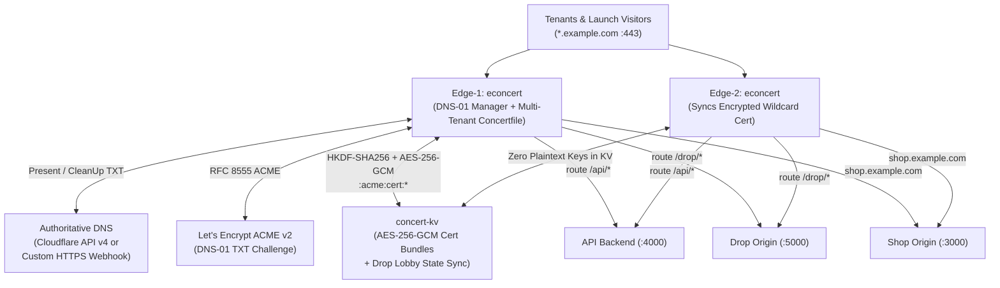

# Tutorial 05: Pure-Stdlib ACME DNS-01 Wildcard TLS (`*.example.com`) & Multi-Tenant `Concertfile` with Scheduled Drops

Provision automatic wildcard TLS certificates (`*.example.com`) using Concert's pure-stdlib **ACME DNS-01** engine (`cloudflare` or generic HTTPS `webhook` provider) with **AES-256-GCM encrypted `concert-kv` certificate sync** across edges—requiring **zero inbound port 80**—and configure a multi-tenant `Concertfile` featuring path-based `route {}` blocks, `header` rules, `redirect` rules, and a cryptographically shuffled **Scheduled Drop** (`drop_event_id`, `drop_lobby_at`, `drop_open_at`).

---

## Topology



---

## Prerequisites

- **DNS Provider (choose one):**
  - **Option A — Cloudflare:** Scoped Cloudflare API Token with `Zone:DNS:Edit` and `Zone:Zone:Read` for `example.com`.
  - **Option B — Generic HTTPS Webhook:** An internal HTTPS endpoint accepting `POST` JSON `{"action":"present"|"cleanup","fqdn":"_acme-challenge.example.com.","value":"<token>"}` with an optional `Authorization: Bearer <token>` header.
- **No port 80 required:** DNS-01 proves domain ownership entirely via DNS TXT records, making it ideal for private networks, split-horizon DNS, and wildcard SANs (`*.example.com`).
- **Binaries:** `econcert` (or `concert` for single-node DNS-01 without `concert-kv` cluster sync) and `concert-kv`.

---

## Step 1: Provision `0600` Secrets (`*_FILE`)

```bash
sudo install -d -m 0750 -o root -g concert /etc/concert /etc/concert/secrets
sudo install -d -m 0700 -o concert -g concert /var/lib/concert/data /var/lib/concert/acme

# Core secrets (CONCERT_ADMIT_SECRET also derives the HKDF-SHA256 AES-256-GCM key for KV cert sync)
sudo sh -c 'umask 077 && openssl rand -base64 48 > /etc/concert/secrets/admit_secret'
sudo sh -c 'umask 077 && openssl rand -hex 32    > /etc/concert/secrets/admin_token'
sudo sh -c 'umask 077 && openssl rand -hex 32    > /etc/concert/secrets/kv_password'
sudo sh -c 'umask 077 && openssl rand -hex 24    > /etc/concert/secrets/portal_pass'

# Option A (Cloudflare): write your scoped API token from your password manager/vault
sudo sh -c 'umask 077 && printf "%s" "$CLOUDFLARE_TOKEN_FROM_VAULT" > /etc/concert/secrets/dns_api_token'

# Option B (Custom Webhook): write your webhook bearer token
# sudo sh -c 'umask 077 && printf "%s" "$DNS_WEBHOOK_TOKEN_FROM_VAULT" > /etc/concert/secrets/dns_webhook_token'

sudo chown root:concert /etc/concert/secrets/*
sudo chmod 0640 /etc/concert/secrets/*
```

> **Zero plaintext keys in KV:** When `-kv-addr` and `CONCERT_ADMIT_SECRET_FILE` are configured, `internal/acme` encrypts every wildcard certificate + private key bundle with **AES-256-GCM** using a subkey derived via HKDF-SHA256 before writing to `<prefix>:acme:cert:*` in `concert-kv`. Every edge sharing `CONCERT_ADMIT_SECRET_FILE` decrypts and serves the wildcard certificate automatically without duplicate ACME rate-limit burn.

---

## Step 2: Author the Multi-Tenant `Concertfile` (DNS-01 + `route {}` + `header` + `redirect` + Scheduled Drop)

Create `/etc/concert/Concertfile`:

```text
{
    listen :443
    tls_email ops@example.com
    tls_cache /var/lib/concert/acme
    tls_dns_provider cloudflare
    # For Option B (Webhook), replace the line above with:
    # tls_dns_provider webhook
    # tls_dns_webhook_url https://dns-automation.internal.example.com/acme-dns01
    tls_min_version 1.3
    hsts_max_age 31536000
    http3 on
    data_dir /var/lib/concert/data
    portal_listen 127.0.0.1:8081
    portal_allow 127.0.0.1/32 ::1/128

    ready_grace 30s
    idle_poll_ttl 45s
    reaper 10s
    upstream_timeout 60s
    upstream_body_idle_timeout 30s
    upstream_cb_failures 5
    upstream_cb_cooldown 15s
}

# Wildcard multi-tenant block matched via RFC 6125 single-label SNI (*.example.com)
*.example.com {
    upstream http://127.0.0.1:3000
    cap 50
    priority_cap 10
    max_queue 2000
    secure_cookie on

    # Response header rules (set / add / remove; forbidden hop-by-hop & Set-Cookie rejected)
    header set X-Content-Type-Options nosniff
    header set Referrer-Policy strict-origin-when-cross-origin
    header add Vary Accept-Encoding
    header remove X-Powered-By

    # Declarative HTTP redirects (301 / 302 / 307 / 308)
    redirect /old-launch /launch 301
    redirect /status https://status.example.com/ 302

    # Longest-prefix path routing overrides
    route /api/v2 {
        upstream http://127.0.0.1:4000
        strip_prefix on
        rate_limit 120/1m:30
        cap 80
    }

    route /webhooks/public {
        upstream http://127.0.0.1:4000
        bypass on
    }

    route /health {
        upstream http://127.0.0.1:3000
        bypass on
    }
}

# Dedicated scheduled drop vhost (covered by the same *.example.com wildcard cert!)
drop.example.com {
    upstream http://127.0.0.1:5000
    cap 40
    priority_cap 10
    max_queue 25000
    secure_cookie on

    # Scheduled Drop lifecycle:
    #   idle -> lobby (collects visitors) -> shuffling (CSPRNG Fisher-Yates at drop_open_at) -> open
    drop_event_id autumn-limited-2026
    drop_lobby_at 2026-12-01T17:30:00Z
    drop_open_at  2026-12-01T18:00:00Z

    header set X-Drop-Platform Concert
    header remove Server
}
```

> **Note:** Use `tls_staging on` in the global block on your first dry run to avoid Let's Encrypt production rate limits while verifying DNS-01 propagation.

---

## Step 3: Configure Edge Environment & Start `econcert`

Create `/etc/concert/concert.env` (`0640 root:concert`):

```ini
CONCERT_CONFIG=/etc/concert/Concertfile
CONCERT_TLS_DOMAINS=*.example.com,example.com

# DNS-01 credential (Option A: Cloudflare; for Option B use CONCERT_DNS_WEBHOOK_TOKEN_FILE)
CONCERT_DNS_API_TOKEN_FILE=/etc/concert/secrets/dns_api_token

# Shared KV for encrypted wildcard cert sync + multi-edge scheduled drop state
CONCERT_KV_ADDR=10.0.2.10:6380
CONCERT_KV_TLS=true
CONCERT_KV_PREFIX=concert:wildcard
CONCERT_KV_PASSWORD_FILE=/etc/concert/secrets/kv_password

# Core file-backed secrets
CONCERT_ADMIT_SECRET_FILE=/etc/concert/secrets/admit_secret
CONCERT_ADMIN_TOKEN_FILE=/etc/concert/secrets/admin_token
CONCERT_PORTAL_PASS_FILE=/etc/concert/secrets/portal_pass
CONCERT_STATS_AUTH=true
```

Start (or `SIGHUP` reload after `Concertfile` changes):

```bash
sudo systemctl restart econcert.service
# Live hot-reload of routes, headers, redirects, and drops without dropping connections:
sudo kill -HUP "$(pidof econcert)"
```

---

## Step 4: Manage the Scheduled Drop Live (`/_room/drop`)

Operators (with `operator` or `admin` role) can inspect, pause, resume, reschedule, or mark a drop sold out (`410 Gone`) without restarting Concert:

```bash
TOKEN="$(sudo cat /etc/concert/secrets/admin_token)"

# 1. Inspect current drop phase, lobby count, and countdown
curl -fsS -H "Authorization: Bearer ${TOKEN}" \
  -H "Host: drop.example.com" \
  "https://drop.example.com/_room/drop" | jq .

# 2. Pause admissions mid-drop (holds waiting visitors safely out of origin)
curl -fsS -X POST "https://drop.example.com/_room/drop" \
  -H "Authorization: Bearer ${TOKEN}" \
  -H "Content-Type: application/json" \
  -d '{"action":"pause","reason":"Inventory sync check"}' | jq .

# 3. Resume admissions
curl -fsS -X POST "https://drop.example.com/_room/drop" \
  -H "Authorization: Bearer ${TOKEN}" \
  -H "Content-Type: application/json" \
  -d '{"action":"resume"}' | jq .

# 4. Mark event sold out (short-circuits all arrivals with HTTP 410 Gone HTML/JSON)
curl -fsS -X POST "https://drop.example.com/_room/drop" \
  -H "Authorization: Bearer ${TOKEN}" \
  -H "Content-Type: application/json" \
  -d '{"action":"sold_out","sold_out_message":"All 2,500 limited editions have been claimed."}' | jq .
```

---

## Step 5: Verification Commands & Expected Outputs

```bash
# 1. Verify wildcard TLS certificate covers arbitrary subdomains (*.example.com)
echo | openssl s_client -servername tenant1.example.com -connect tenant1.example.com:443 2>/dev/null \
  | openssl x509 -noout -subject -ext subjectAltName -dates
# Expected: DNS:*.example.com (and valid Let's Encrypt issuer)

# 2. Verify declarative redirect rule (301) and header mutations
curl -sSI "https://tenant1.example.com/old-launch" | grep -iE '^(HTTP/|location:)'
# Expected: HTTP/2 301 and Location: /launch

curl -sSI "https://tenant1.example.com/" | grep -iE '^(x-content-type-options:|x-powered-by:)'
# Expected: x-content-type-options: nosniff (and NO x-powered-by header)

# 3. Verify path-based route with strip_prefix + rate_limit
curl -fsS "https://tenant1.example.com/api/v2/ping"
# Expected: served by 127.0.0.1:4000 as GET /ping

# 4. Verify scheduled drop API JSON contract while in lobby phase
curl -sS -H "Accept: application/json" "https://drop.example.com/" | jq '{queued, drop_event_id, drop_phase, drop_countdown_seconds}'
# Expected: {"queued": true, "drop_event_id": "autumn-limited-2026", "drop_phase": "lobby", "drop_countdown_seconds": ...}
```

---

## Troubleshooting & Rollback

| Symptom | Diagnosis | Fix |
| --- | --- | --- |
| `acme: dns-01 txt propagation timed out` | DNS TXT record slow to propagate or wrong zone permissions | Verify Cloudflare API token has `Zone:DNS:Edit` on the parent zone; check `_acme-challenge.example.com` TXT via `dig TXT _acme-challenge.example.com @1.1.1.1`. |
| Edge-2 cannot decrypt wildcard cert from `concert-kv` | `CONCERT_ADMIT_SECRET_FILE` differs between Edge-1 and Edge-2 | Sync identical `admit_secret` bytes to all edges and restart Edge-2. |
| `Concertfile` reload rejected on `SIGHUP` | Syntax error or forbidden header rule (e.g. `header set Set-Cookie ...`) | Check `journalctl -u econcert`; Concert keeps the previous valid generation serving until the syntax error is fixed. |

### Rollback Procedure

```bash
# Restore previous Concertfile and reload atomically with zero dropped connections:
sudo cp /etc/concert/Concertfile.bak /etc/concert/Concertfile
sudo kill -HUP "$(pidof econcert)"

# Or reset an active scheduled drop immediately back to standard waiting-room mode:
curl -fsS -X POST "https://drop.example.com/_room/drop" \
  -H "Authorization: Bearer $(sudo cat /etc/concert/secrets/admin_token)" \
  -H "Content-Type: application/json" \
  -d '{"action":"reset"}'
```
