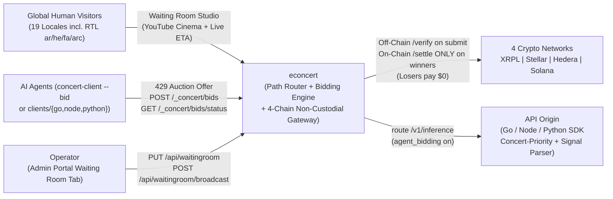

# Tutorial 06: High-Traffic API Routing, 4-Chain Crypto Agent Pass Bidding & Waiting Room Studio

Configure **`econcert`** for high-traffic API path routing with **100% crypto-only** (`XRPL`, `Stellar`, `Hedera`, `Solana`) Fast-Lane & non-custodial **AI Agent Pass Bidding** (`/_concert/bids`, where losing bidders pay **`$0`**), drive automated bidding with **`concert-client --bid --max-bid`**, integrate origin services using **`clients/{go,node,python}`**, and brand the human visitor experience with **Waiting Room Studio** (`youtube` cinema layout + 19 locales including RTL).

---

## Topology



---

## Prerequisites

- **Binary:** `econcert` (`go build -tags "wordpress,enterprise" ./cmd/econcert`) and `concert-client` (`go build ./cmd/concert-client`).
- **4-Chain RPC Endpoints (`networks.json`):** Mainnet or testnet endpoints for XRPL, Stellar, Hedera, and/or Solana (zero hot keys required by default when `areFeesSponsored: false` — payers cover their own network fees).
- **Client SDKs:** [`clients/go/`](../../clients/go/), [`clients/node/`](../../clients/node/), and [`clients/python/`](../../clients/python/).
- **100% Crypto-Only:** Supported chains are strictly `xrpl`, `stellar`, `hedera`, and `solana`. No fiat processors or license keys exist anywhere in Concert.

---

## Step 1: Provision Secrets & 4-Chain Fast-Lane Configuration

```bash
sudo install -d -m 0750 -o root -g concert /etc/concert /etc/concert/secrets
sudo install -d -m 0700 -o concert -g concert /var/lib/concert/data

sudo sh -c 'umask 077 && openssl rand -base64 48 > /etc/concert/secrets/admit_secret'
sudo sh -c 'umask 077 && openssl rand -hex 32    > /etc/concert/secrets/admin_token'
sudo sh -c 'umask 077 && openssl rand -hex 24    > /etc/concert/secrets/portal_pass'
sudo chown root:concert /etc/concert/secrets/*
sudo chmod 0640 /etc/concert/secrets/*
```

Create `/etc/concert/networks.json` (example using testnets for staging; swap CAIP-2 IDs and RPC URLs for mainnet per [`docs/FASTLANE.md`](../FASTLANE.md)):

```json
{
  "networks": {
    "xrpl:1": {
      "rpc": "https://s.altnet.rippletest.net:51234"
    },
    "stellar:testnet": {
      "horizon": "https://horizon-testnet.stellar.org",
      "soroban_rpc": "https://soroban-testnet.stellar.org"
    },
    "hedera:testnet": {
      "mirror": "https://testnet.mirrornode.hedera.com",
      "consensus": "0.testnet.hedera.com:50212"
    },
    "solana:EtWTRABZaYq6iMfeYKouRu166VU2xqa1": {
      "rpc": "https://api.devnet.solana.com"
    }
  }
}
```

Create `/etc/concert/fastlane.json` defining your 4-chain receiving wallets (`payTo`) and offers (zero private keys stored on the server):

```json
{
  "origin": "https://api.example.com",
  "pass_sliding": true,
  "pass_idle_seconds": 180,
  "pass_max_seconds": 1800,
  "offers": [
    { "network": "xrpl:1", "asset": "XRP", "amount": "1000000", "display_amount": "1.00", "asset_symbol": "XRP", "payTo": "rMerchantXRPLAddress..." },
    { "network": "stellar:testnet", "asset": "XLM", "amount": "10000000", "display_amount": "1.00", "asset_symbol": "XLM", "payTo": "GMERCHANTSTELLARADDRESS..." },
    { "network": "hedera:testnet", "asset": "0.0.0", "display_amount": "1.00", "asset_symbol": "HBAR", "amount": "100000000", "payTo": "0.0.123456" },
    { "network": "solana:EtWTRABZaYq6iMfeYKouRu166VU2xqa1", "asset": "SOL", "amount": "10000000", "display_amount": "0.01", "asset_symbol": "SOL", "payTo": "MerchantSolanaPubkey..." }
  ]
}
```

---

## Step 2: Configure Path-Routed `Concertfile` with AI Agent Pass Bidding

Create `/etc/concert/Concertfile`:

```text
{
    listen :443
    http_listen :80
    tls_email ops@example.com
    tls_cache /var/lib/concert/acme
    hsts_max_age 31536000
    http3 on
    data_dir /var/lib/concert/data
    portal_listen 127.0.0.1:8081
    portal_allow 127.0.0.1/32 ::1/128
    fastlane_lock_destinations on
}

api.example.com {
    upstream http://127.0.0.1:4000
    cap 60
    priority_cap 20
    max_queue 5000
    secure_cookie on
    fastlane_config /etc/concert/fastlane.json
    networks_config /etc/concert/networks.json

    # High-demand API route enabling hybrid instant-buy / sealed-bid crypto auctions
    route /v1/inference {
        upstream http://127.0.0.1:4100
        rate_limit 60/1m:15
        cap 40
        agent_bidding on
    }

    # Public metadata endpoint bypasses the queue
    route /v1/catalog {
        upstream http://127.0.0.1:4000
        bypass on
    }
}
```

Create `/etc/concert/econcert.env` (`0640 root:concert`):

```ini
CONCERT_CONFIG=/etc/concert/Concertfile
CONCERT_ADMIT_SECRET_FILE=/etc/concert/secrets/admit_secret
CONCERT_ADMIN_TOKEN_FILE=/etc/concert/secrets/admin_token
CONCERT_PORTAL_PASS_FILE=/etc/concert/secrets/portal_pass

# Enable Agent Queue & Non-Custodial Crypto Pass Bidding
CONCERT_AGENT_QUEUE=true
CONCERT_AGENT_PLACES=4
CONCERT_AGENT_BIDDING=true
CONCERT_AGENT_BIDDING_FLOOR=1000000     # $1.00 floor in exact integer micro-USD
CONCERT_AGENT_BIDDING_EPOCH=15s         # Sealed-bid clearing window under saturation
CONCERT_AGENT_BIDDING_SLOTS=5           # Priority passes awarded per epoch
CONCERT_AGENT_BIDDING_MIN_WAIT=0s       # Optional anti-sniping min wait before bidding
CONCERT_STATS_AUTH=true
```

How the hybrid non-custodial auction works:
- When capacity is open, Concert offers **`instant`** mode at the floor price (`floor_micro_usd`).
- Under saturation, Concert automatically switches to **`auction`** (sealed-bid clearing epochs).
- On `POST /_concert/bids`, Concert verifies the agent's signed crypto authorization **off-chain** (`/verify`).
- At epoch close, Concert calls on-chain `/settle` **ONLY for winning bids** and issues signed `concert_admit` + `concert_priority` passes. **Losing bids are never broadcast and pay `$0`.**

---

## Step 3: Run Autonomous Bidding with `concert-client`

An AI agent runs `concert-client` with a strict local `-max-bid` ceiling (exact integer micro-USD parsing, never `float64`) and local wallet signing:

```bash
export CONCERT_ORIGIN="https://api.example.com"
export CONCERT_CLIENT_NETWORK="xrpl:1"
export CONCERT_NETWORKS_CONFIG="/etc/concert/networks.json"
# Load wallet seed from a 0600 file on disk (never hardcode in shell history)
export CONCERT_CLIENT_XRP_SEED="$(cat ~/.secrets/agent-xrpl-testnet.seed)"

# Wait in line on /v1/inference and automatically bid up to $2.50 in XRP if queued
concert-client \
  --wait /v1/inference \
  --bid \
  --max-bid 2.50 \
  --bid-chain xrpl \
  --bid-asset XRP \
  --bid-poll-interval 1s
```

Behavior guarantees:
- If `floor_micro_usd > 2_500_000` (`$2.50`), `concert-client` skips bidding and waits fairly in FIFO order.
- If the bid loses the epoch, `concert-client` logs `$0 charged` and stays in its existing FIFO queue spot without losing position.
- If the bid wins and settles on-chain, `concert-client` attaches the returned pass credentials (`Set-Cookie` / `pass_token`) and retries `/v1/inference` immediately through the priority lane.

---

## Step 4: Integrate Your Origin & Agents with `clients/{go,node,python}`

### Go (`clients/go` — Zero External Dependencies)

```go
// Origin middleware: emit Concert-Priority & parse waiting-room signals
// See clients/go/README.md for full module setup (clients/go/src/go.mod).
w.Header().Set("Concert-Priority", "subscriber; ttl=30m")
```

### Node.js / TypeScript (`clients/node` — Zero Runtime npm Dependencies)

```ts
// Express / Next.js middleware + AgentBidClient + WaitingRoomSignal parser
// See clients/node/README.md for full ESM / TypeScript usage.
import { priorityMiddleware, parseWaitingRoomSignal, AgentBidClient } from "@concert/client";

app.use(priorityMiddleware((req) => (req.user?.isSubscriber ? "subscriber" : "member")));
```

### Python (`clients/python` — Pure Python 3.10+ Stdlib)

```python
# FastAPI / ASGI or Flask / WSGI middleware + AgentBidClient
# See clients/python/README.md for full ASGI/WSGI & bidding client examples.
from concert_client.signals import parse_waiting_room_signal
from concert_client.bidding import AgentBidClient
```

---

## Step 5: Configure Waiting Room Studio (`youtube` Cinema Layout + 19 Locales incl. RTL)

Configure Waiting Room Studio via the Admin Portal **Waiting Room** tab (or directly via the Portal API; persisted atomically with `0600` permissions to `/var/lib/concert/data/waitingroom.json`):

- **5 Layouts:** `default`, `youtube` (widescreen YouTube Cinema stage), `drop-countdown`, `minimal-brand`, `split-stage`.
- **10 WCAG Themes + `system`:** `system`, `paper`, `synthwave84`, `solarized-light`, `solarized-dark`, `nord`, `dracula`, `gruvbox-dark`, `github-light`, `github-dark`, `high-contrast`.
- **19 Built-In Locales (auto-negotiated via `?lang=`, `concert_lang` cookie, `Accept-Language`, or `default_locale`):**
  - **LTR (15):** `en`, `es`, `es-MX`, `fr`, `fr-CA`, `ro`, `ru`, `tr`, `de`, `it`, `ja`, `zh-CN`, `hi`, `pl`, `sr`
  - **RTL (4, automatic `dir="rtl"`):** `ar` (Arabic), `he` (Hebrew), `fa` (Persian), `arc` (Aramaic / Syriac)
- **Strict Dynamic CSP:** `frame-src 'none'` on every layout except `youtube` with a validated 11-character video ID, which narrows `frame-src` exclusively to `https://www.youtube-nocookie.com`.

Example Portal API update (`PUT /api/waitingroom` with Portal session cookie + CSRF token) and live operator broadcast (`POST /api/waitingroom/broadcast`):

```bash
# Example waitingroom.json schema (managed via Portal -> Waiting Room tab -> Save)
cat <<'EOF'
{
  "layout": "youtube",
  "theme": "synthwave84",
  "brand_name": "Concert Launch Stage",
  "accent_color": "#00D4FF",
  "headline": "Welcome to the Waiting Room",
  "subheadline": "Enjoy the stream while we admit visitors fairly in order.",
  "youtube_video_id": "dQw4w9WgXcQ",
  "default_locale": "en",
  "broadcast": {
    "message": "Batch #2 is admitting now — average wait under 45 seconds."
  }
}
EOF
```

---

## Step 6: Verification Commands & Expected Outputs

```bash
TOKEN="$(sudo cat /etc/concert/secrets/admin_token)"

# 1. Verify waiting-room localization + RTL rendering (?lang=ar and ?lang=arc)
curl -sS -H "Accept: text/html" "https://api.example.com/v1/inference?lang=ar" | grep -o 'dir="rtl"'
# Expected (when room is busy): dir="rtl"

# 2. Verify strict YouTube CSP scoping when layout=youtube is active
curl -sSI -H "Accept: text/html" "https://api.example.com/v1/inference" | grep -i '^content-security-policy:'
# Expected: frame-src https://www.youtube-nocookie.com (and frame-src 'none' on all other layouts)

# 3. Verify waiting-room signal headers & auction metadata on queued API/agent 429 responses
curl -sSi -H "Accept: application/json" "https://api.example.com/v1/inference" | grep -iE '^(HTTP/|x-concert-queue:|x-concert-position:|retry-after:)'
# Expected (when queued):
# HTTP/2 429
# x-concert-queue: 1
# x-concert-position: <N>
# retry-after: 5

# 4. Verify bidding Prometheus counters
curl -fsS -H "Authorization: Bearer ${TOKEN}" "https://api.example.com/_room/metrics" \
  | grep -E '^concert_bidding_(submitted|settled|rejected)_total'
# Expected:
# concert_bidding_submitted_total ...
# concert_bidding_settled_total ...
# concert_bidding_rejected_total ...
```

---

## Troubleshooting & Rollback

| Symptom | Diagnosis | Fix |
| --- | --- | --- |
| `POST /_concert/bids` returns `404 agent_bidding_disabled` | Neither `-agent-bidding` nor route `agent_bidding on` enabled | Set `CONCERT_AGENT_BIDDING=true` or add `agent_bidding on` inside the target `route {}` block. |
| `POST /_concert/bids` returns `402 gateway_not_configured` | `fastlane_config` / `networks_config` missing | Concert fails closed when no 4-chain gateway is attached; verify both JSON files load cleanly at startup. |
| YouTube embed does not render in Waiting Room | Video ID failed `^[A-Za-z0-9_-]{11}$` validation or layout != `youtube` | Paste any standard YouTube watch/live/youtu.be URL or 11-char ID in the Portal Waiting Room tab and select layout `youtube`. |

### Rollback Procedure

```bash
# Disable agent bidding immediately while keeping standard FIFO waiting room & Fast-Lane active:
# Set CONCERT_AGENT_BIDDING=false in /etc/concert/econcert.env (and remove agent_bidding on from route blocks)
sudo systemctl restart econcert.service

# Revert Waiting Room Studio to built-in defaults cleanly:
sudo rm -f /var/lib/concert/data/waitingroom.json
sudo systemctl restart econcert.service
```
