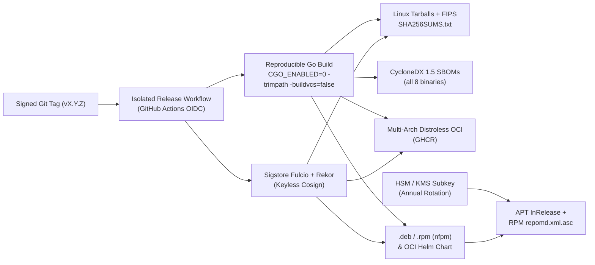

# RFC: Concert Suite Package Managers & Signed Artifact Distribution

> **Status: DEFERRED ENGINEERING RFC — Awaiting Senior Peer Review**
>
> **Implementation State:** Intentionally **not** implemented or scheduled. Per the author's explicit decision, Concert `v0.3.0` ships exclusively via reproducible static Linux tarballs (`make dist`), CycloneDX 1.5 SBOMs, `SHA256SUMS.txt`, multi-arch distroless Dockerfiles (`Dockerfile`, `Dockerfile.wpconcert`, `Dockerfile.econcert`), and the confined systemd/SELinux `installer.sh`. Do **not** open package-repository PRs, tap repositories, or Helm charts until senior peer reviewers sign off on the Go/No-Go checklist in [Section 7](#7-senior-peer-review-gono-go-checklist).

---

## 1. Executive Summary & Why This Is Deferred

Concert is a zero-CGO Go suite (`CGO_ENABLED=0`, Go 1.27+) targeting Linux production servers and Kubernetes clusters. Today, operators already have three clean, zero-lock-in installation paths:

1. **Reproducible static tarballs** (`make dist` → `dist/<binary>-v0.3.0-linux-{amd64,arm64}.tar.gz` + `dist/SHA256SUMS.txt` + CycloneDX 1.5 SBOMs).
2. **Hardened systemd + SELinux host installation** (`installer.sh` supporting `CONCERT_SHA256` verification, `concert_etc_t` labeling, `CONCERT_WATCHDOG=1`, and atomic upgrades).
3. **Multi-arch distroless containers** (`make docker-buildx` targeting `gcr.io/distroless/static-debian12:nonroot`, `linux/amd64` + `linux/arm64`, with optional `GOFIPS140=v1.0.0`).

Adding native OS package managers (`.deb` / APT, `.rpm` / DNF), a Homebrew tap, an OCI Helm chart, and Cosign-signed GHCR container pipelines improves day-one ergonomics for platform teams, **but introduces permanent operational liabilities**:

- **Signing-key custody & rotation:** APT/RPM GPG keys and Cosign identity policies become high-value supply-chain targets.
- **Repository hosting & CDN availability:** Broken APT/RPM metadata breaks automated fleet upgrades.
- **OS lifecycle matrix testing:** Debian, Ubuntu, Rocky/RHEL, Fedora, macOS, and Kubernetes version skew multiplies CI surface area.
- **Upgrade/rollback semantics:** Post-install scripts (`postinst`/`%post`) can conflict with operator-managed `installer.sh` units and SELinux policies if not carefully isolated.

This RFC captures the complete reference architecture for all five distribution channels so senior engineers can evaluate trade-offs objectively in a future review cycle rather than improvising under release pressure.

---

## 2. Full Concert Suite Packaging Inventory (`v0.3.0`)

Every distribution channel must account for the entire **8-binary Concert Suite** plus the **3 FIPS 140-3 builds** defined in `Makefile`:

| Binary | Build Tags / Mode | Role in Suite | Default Runtime Context |
|---|---|---|---|
| `concert` | Default (`CGO_ENABLED=0`) | Core FIFO waiting-room reverse proxy & front-door server | Dedicated system service (`concert.service`) |
| `wpconcert` | `-tags wordpress` | Multi-host WordPress + PHP-FPM FastCGI front-door server | Dedicated system service (mutually exclusive with `concert`/`econcert` on `:80/:443`) |
| `econcert` | `-tags "wordpress,enterprise"` | Enterprise active-active mesh, x402 crypto Fast-Lane & multi-tenant front door | Dedicated system service |
| `concert-kv` | Default (pure stdlib) | 64-shard RESP2 KV, Pub/Sub, CRC32 WAL & replication daemon | Dedicated state service (`concert-kv.service`) |
| `concert-cache` | Default (pure stdlib) | External micro-cache daemon with active purge API | Dedicated cache service (`concert-cache.service`) |
| `concert-watchdog` | Default (pure stdlib) | Independent liveness supervisor distinguishing origin vs. Concert faults | Supervisor wrapper or companion unit (`concert-watchdog.service`) |
| `concert-client` | Default | Operator/AI-agent CLI for waiting-room polling, NFT VIP, and 4-chain pass bidding | Interactive CLI / automation host |
| `bench-concert` | Default | Capacity ramp-and-bisect, fairness, and `soak-100k` load generator | Staging / benchmark host |
| `concert-fips` | `GOFIPS140=v1.0.0` (Linux) | FIPS 140-3 validated Core binary | Regulated Linux hosts |
| `wpconcert-fips` | `-tags wordpress`, `GOFIPS140=v1.0.0` | FIPS 140-3 validated WordPress binary | Regulated Linux hosts |
| `econcert-fips` | `-tags "wordpress,enterprise"`, `GOFIPS140=v1.0.0` | FIPS 140-3 validated Enterprise binary | Regulated Linux hosts |

### 2.1 Logical Package Split Strategy

Rather than shipping one monolithic package (which would force `bench-concert` onto production edges or install `wpconcert` alongside `concert`), native packages should split cleanly:

| Package Name | Contents | Conflicts / Coexistence |
|---|---|---|
| `concert` | `/usr/bin/concert`, `concert.service`, default `/etc/concert/` skeleton | `Provides: concert-frontdoor`; `Conflicts: wpconcert, econcert` (or side-by-side via drop-in binary path if peer review prefers coexistence) |
| `wpconcert` | `/usr/bin/wpconcert`, `wpconcert.service` | `Provides: concert-frontdoor` |
| `econcert` | `/usr/bin/econcert`, `econcert.service` | `Provides: concert-frontdoor` |
| `concert-fips` / `wpconcert-fips` / `econcert-fips` | FIPS 140-3 Linux binaries (`GOFIPS140=v1.0.0`) | Replaces corresponding non-FIPS front-door package |
| `concert-kv` | `/usr/bin/concert-kv`, `concert-kv.service`, `/var/lib/concert-kv` | Coexists with any front door |
| `concert-cache` | `/usr/bin/concert-cache`, `concert-cache.service` | Coexists with any front door |
| `concert-watchdog` | `/usr/bin/concert-watchdog`, `concert-watchdog.service` | Coexists with any front door |
| `concert-tools` | `/usr/bin/concert-client`, `/usr/bin/bench-concert` | Stateless CLI package; safe on workstations, bastions, and CI runners |
| `concert-selinux` (RPM only) | Compiled SELinux policy module (`concert.pp`) matching `installer.sh` | Recommended (`Recommends:`) by front-door and daemon RPMs on EL9/Fedora |

### 2.2 Canonical Linux FHS & Security Layout

All `.deb` and `.rpm` packages must adhere strictly to Filesystem Hierarchy Standard paths and least-privilege secret handling:

```text
/usr/bin/
├── concert | wpconcert | econcert        (0755 root:root)
├── concert-kv                            (0755 root:root)
├── concert-cache                         (0755 root:root)
├── concert-watchdog                      (0755 root:root)
├── concert-client                        (0755 root:root)
└── bench-concert                         (0755 root:root)

/etc/concert/                             (0750 root:concert)
├── concert.env                           (0640 root:concert — non-secret runtime flags ONLY; marked conffile/noreplace)
├── Concertfile                           (0640 root:concert — marked conffile/noreplace)
├── fastlane.example.json                 (0644 root:root)
├── networks.example.json                 (0644 root:root)
└── secrets/                              (0700 concert:concert — *_FILE secret mounts; NEVER populated by package)

/var/lib/concert/                         (0750 concert:concert)
├── data/                                 (audit.jsonl, waitingroom.json, gateway journal — 0600 atomic writes)
├── acme/                                 (TLS certs/keys — 0600)
└── naddr/                                (ip2asn-combined.tsv.gz)

/var/lib/concert-kv/                      (0700 concert-kv:concert-kv — CRC32 WAL & snapshots)
/run/concert/                             (0750 concert:concert — via RuntimeDirectory=concert, Unix sockets 0600)
/usr/lib/systemd/system/                  (systemd units with DynamicUser=no, dedicated nologin users, ProtectSystem=strict, NoNewPrivileges=yes)
/usr/share/doc/concert/                   (LICENSE, VERSION, README snippets)
```

**Secret-Handling Invariant (Non-Negotiable):**
- Packages **never** generate default passwords, embed placeholder secrets, or place secret values in `Environment=` directives or CLI arguments.
- Systemd units use `LoadCredential=` / `EnvironmentFile=` pointing strictly to `*_FILE` paths (`CONCERT_KV_PASSWORD_FILE`, `CONCERT_CACHE_SECRET_FILE`, `CONCERT_ACME_KV_SECRET_FILE`, `CONCERT_NOTIFY_WEBHOOK_SECRET_FILE`) stored `0600` under `/etc/concert/secrets/` or `/run/credentials/`.

---

## 3. Channel-by-Channel Technical Design

### 3.1 `.deb` (APT Repository — Debian 12/13, Ubuntu 22.04/24.04)

- **Build Tooling:** `nfpm` (pure Go, declarative YAML config per sub-package, zero `dpkg-deb` host dependency, reproducible timestamps via `SOURCE_DATE_EPOCH`).
- **Architectures:** `amd64`, `arm64`.
- **Maintainer Scripts (Minimal & Idempotent):**
  - `preinst`: Create locked system account (`concert` / `concert-kv` / `concert-cache`) with `/usr/sbin/nologin` if absent.
  - `postinst`: Run `systemd-tmpfiles --create`, `systemctl daemon-reload`, **do not auto-start** on first install until operator configures `Concertfile` / `concert.env`; on upgrade (`$1 = "configure"` with `$2` non-empty), run `systemctl try-reload-or-restart`.
  - `prerm`: Stop service on `remove` (preserve `/etc/concert` and `/var/lib/concert`).
  - `postrm`: Only delete state directories on explicit `purge` (matching `installer.sh`'s `PURGE=1` semantics).
- **Repository Hosting & APT Security:**
  - Modern DEB822 format (`/etc/apt/sources.list.d/concert.sources`) with scoped `Signed-By: /usr/share/keyrings/concert-archive-keyring.gpg` (never deprecated `apt-key`).
  - Signed `InRelease` + `Release.gpg` generated via `aptly` or `reprepro` in an isolated release pipeline, published to a versioned static bucket/CDN with immutable `.deb` filenames.

### 3.2 `.rpm` (DNF/YUM Repository — Rocky 9, RHEL 9, AlmaLinux 9, Fedora)

- **Build Tooling:** `nfpm` (or `rpmbuild` inside a clean EL9 container if SELinux policy compilation requires `selinux-policy-devel` / `checkmodule` / `semodule_package`).
- **Architectures:** `x86_64`, `aarch64`.
- **Config Preservation:** All files under `/etc/concert/` marked `%config(noreplace)` so upgrades never overwrite operator routing, Fast-Lane, or ACME configuration.
- **SELinux Parity Requirement:**
  - Today, `installer.sh` compiles and installs a custom SELinux policy (`concert_etc_t`, port labels for XRPL `51234`, Hedera `50211`, `concert_bind_any_port` boolean).
  - The `.rpm` path **must not regress SELinux enforcing hosts**. Either ship a companion `concert-selinux` noarch RPM invoking `semodule -i /usr/share/selinux/packages/concert.pp` in `%post`, or explicitly document that SELinux-enforcing EL9 fleets should remain on `installer.sh` until `concert-selinux` is audited.
- **Repository Signing:** Sign every `.rpm` header (`rpmsign --addsign`) and sign `repodata/repomd.xml` (`repomd.xml.asc`), with `gpgcheck=1` and `repo_gpgcheck=1` enabled by default in `concert.repo`.

### 3.3 Homebrew Tap (`brew install`)

- **Scope & Target Audience:** Developer laptops, staging bastions, and CI operators on macOS (`arm64`, `amd64`) and Linuxbrew (`amd64`, `arm64`).
- **Repository:** Dedicated tap repository `github.com/andreimerlescu/homebrew-tap` (auto-updated only on signed GitHub Releases, never from `main`).
- **Formula Split:**
  - `concert-client` (primary workstation formula — lightweight CLI for testing queues and crypto agent bidding).
  - `bench-concert` (benchmarking & `soak-100k` load generator).
  - `concert` (local development front door + optional `brew services` plist for localhost testing).
  - `concert-suite` (meta-formula or separate formulae for `wpconcert`, `econcert`, `concert-kv`, `concert-cache`, `concert-watchdog`).
- **Binary Artifact Pre-requisite:** `Makefile` currently cross-compiles `PLATFORMS := linux/amd64 linux/arm64`. Supporting macOS bottles in Homebrew requires adding `darwin/arm64` and `darwin/amd64` tarballs to release automation (excluding Linux-only FIPS binaries) OR building from source tarball with `depends_on "go" => :build`.
- **Integrity:** Every formula pins exact `url` + `sha256` from `dist/SHA256SUMS.txt` and includes a deterministic `test do` block (`assert_match version.to_s, shell_output("#{bin}/concert -version")`).

### 3.4 Helm Chart (`oci://ghcr.io/andreimerlescu/charts/concert`)

- **Registry:** Distribute strictly as an **OCI Helm chart** in GHCR (`helm push ... oci://ghcr.io/andreimerlescu/charts`), signed with Cosign—eliminating the need to maintain a separate `gh-pages` `index.yaml` chart repo.
- **Chart Architecture (Reflecting Wave 1 & Wave 2 Capabilities):**
  - **Front-door workload (`Deployment` or `StatefulSet`):** Selectable edition (`concert` | `wpconcert` | `econcert`, standard or `-fips` image tag), non-root `securityContext` (`runAsUser: 65532`, `readOnlyRootFilesystem: true`, `allowPrivilegeEscalation: false`, `capabilities.drop: ["ALL"]`), `PodDisruptionBudget`, `HorizontalPodAutoscaler`, and `Service` (TCP `80`/`443` + UDP `443` for HTTP/3 QUIC).
  - **Optional `concert-kv` sub-component (`StatefulSet`):** Primary + replica topology with PVC for CRC32 WAL/snapshots, headless Service, and mTLS/password loaded strictly from an existing Kubernetes `Secret` or External Secrets Operator CSI mount (`existingSecret`, never plaintext in `values.yaml`).
  - **Optional `concert-cache` sub-component (`Deployment`):** Dedicated cache pool wired via `CONCERT_CACHE_ADDR` and `CONCERT_CACHE_SECRET_FILE`.
  - **Observability templates:** Toggleable `ServiceMonitor`, `PrometheusRule` (templated directly from `deploy/observability/prometheus-rules.yaml`), Grafana dashboard `ConfigMap` (from `deploy/observability/grafana-dashboard.json`), and OTLP env wiring (`CONCERT_OTLP_ENDPOINT`, `CONCERT_OTLP_AUTH_HEADER_FILE`).
  - **Persistent state:** Optional PVC for `<data-dir>` (`audit.jsonl`, `waitingroom.json`, gateway journal, ACME state when not using `concert-kv` cert sync).
- **Schema Validation:** Ship `values.schema.json` to reject invalid combinations (e.g., enabling `cache.enabled=true` without `cache.existingSecret`, or enabling `econcert` shared queue without `kv.enabled=true` or external `kv.addr`).

### 3.5 Cosign-Signed GHCR Container Releases

- **Target Images (`ghcr.io/andreimerlescu/<name>`):**
  - Existing Dockerfiles: `concert`, `wpconcert`, `econcert` (plus `-fips` variants built with the `GOFIPS140` Dockerfile build argument set to `v1.0.0`).
  - Proposed companion Dockerfiles (all `gcr.io/distroless/static-debian12:nonroot`, `USER 65532:65532`): `concert-kv`, `concert-cache`, `concert-watchdog`, `concert-client`, `bench-concert`.
- **Multi-Arch Manifests:** `linux/amd64` + `linux/arm64` published as OCI image indexes via `docker/build-push-action` with immutable digest pinning.
- **Tagging Policy:**
  - Immutable semver tags: `v0.3.0`, `v0.3.0-fips`, `v0.3`, `sha-<shortcommit>`.
  - Mutable convenience tags (`latest`, `latest-fips`) updated only on stable non-prerelease Git tags.
- **Keyless Signing & Attestations:**
  - Authenticate to GHCR via GitHub Actions `GITHUB_TOKEN` with `packages: write` and `id-token: write` (OIDC — zero static PATs).
  - Sign every manifest digest with **Sigstore Cosign keyless OIDC** (`cosign sign --yes ghcr.io/andreimerlescu/concert@sha256:...`).
  - Attach **CycloneDX 1.5 SBOM** (`cosign attest --type cyclonedx`) and **SLSA Level 3 build provenance** (`actions/attest-build-provenance`).

---

## 4. Signing, SBOM & Supply-Chain Provenance Chain



### 4.1 Key Custody & Rotation Policy (Aligned with `security-posture`)

| Trust Mechanism | Key Model | Rotation Cadence | Blast Radius Mitigation |
|---|---|---|---|
| **GHCR Images, Tarballs, Helm OCI, SBOMs** | Sigstore Keyless OIDC (Fulcio short-lived certs + Rekor log) | Ephemeral per build (~10 min cert TTL) | Bound to exact repo + workflow ref (`--certificate-identity-regexp` + `--certificate-oidc-issuer`); zero long-lived CI secrets |
| **APT & RPM GPG Signing** | Offline air-gapped primary key + dedicated signing subkey in Cloud KMS or YubiKey HSM | Annual subkey rotation; 30-day dual-key overlap window | Dedicated release environment with manual senior maintainer approval; raw private key never stored in git or unencrypted CI env |
| **CycloneDX 1.5 SBOMs** | Extended `scripts/generate-sbom.py` covering all 8 binaries (currently covers `concert`, `wpconcert`, `econcert`) | Generated per release tag | Verified against `go.mod` + `go.sum` (`go mod verify`) and `govulncheck` before publish |

### 4.2 End-User Verification Commands (Target UX)

```bash
# 1. Verify container image signature + SLSA provenance (keyless OIDC)
cosign verify \
  --certificate-identity-regexp '^https://github\.com/andreimerlescu/concert/\.github/workflows/release\.yml@refs/tags/v' \
  --certificate-oidc-issuer 'https://token.actions.githubusercontent.com' \
  ghcr.io/andreimerlescu/concert@sha256:<digest>

# 2. Verify CycloneDX SBOM attestation
cosign verify-attestation --type cyclonedx \
  --certificate-identity-regexp '^https://github\.com/andreimerlescu/concert/\.github/workflows/release\.yml@refs/tags/v' \
  --certificate-oidc-issuer 'https://token.actions.githubusercontent.com' \
  ghcr.io/andreimerlescu/concert@sha256:<digest>

# 3. Verify release tarball checksums
sha256sum -c dist/SHA256SUMS.txt
```

---

## 5. Maintenance Burden & Trade-Off Analysis

| Channel | Initial Effort | Ongoing Release Tax | Key Custody Risk | Test Matrix Cost | User Demand Signal | Recommended Phase |
|---|---|---|---|---|---|---|
| **Cosign-Signed GHCR Images** | Low (1–2 days; Dockerfiles already exist) | Near-zero (automated on tag) | Very Low (keyless OIDC) | Low (`amd64`/`arm64` smoke) | High (K8s, Docker Compose, enterprise) | **Phase 0** (First candidate) |
| **Homebrew Tap (`concert-client`, `bench-concert`, `concert`)** | Low (1–2 days; needs Darwin release builds) | Low (automated PR to tap) | Very Low (SHA-256 pinned) | Low (macOS + Linuxbrew) | Medium-High (dev/SRE workstation UX) | **Phase 1** |
| **OCI Helm Chart** | Medium (3–5 days; templating + schema + `kind` CI) | Medium (K8s API deprecations, values drift) | Very Low (keyless Cosign) | Medium (`helm lint`, `ct`, `kind` E2E) | High for K8s fleets; zero for VPS users | **Phase 2** |
| **`.deb` (APT Repo)** | Medium-High (4–6 days; `nfpm` + repo hosting + GPG) | High (Debian/Ubuntu LTS churn, repo hosting) | **High** (GPG signing key) | High (Debian 12/13, Ubuntu 22.04/24.04 clean VM tests) | Medium (Linux sysadmins) | **Phase 3** |
| **`.rpm` (DNF/YUM + SELinux)** | High (5–8 days; `nfpm` + `concert-selinux` parity) | High (EL9/EL10/Fedora + SELinux policy drift) | **High** (GPG signing key) | High (Rocky/Alma/Fedora enforcing VMs) | Medium (`installer.sh` already serves EL9 well) | **Phase 3** |

### Why Deferring Now Is the Right Engineering Call

- **`installer.sh` already covers hardened Linux/SELinux hosts** with checksum verification, SELinux policy compilation, `CONCERT_WATCHDOG=1`, and zero external repo dependencies.
- **`make dist` + `Makefile` Docker targets already cover reproducible tarballs and distroless containers.**
- Prematurely publishing an unmaintained APT/RPM repo or an out-of-date Helm chart damages trust far more than shipping rock-solid static binaries and clear tutorials (`docs/tutorials/`).

---

## 6. Open Technical Questions for Peer Review

Senior reviewers should resolve these five design decisions before moving any phase from **Deferred** to **Accepted**:

1. **Front-door coexistence vs. exclusivity:** Should `concert`, `wpconcert`, and `econcert` conflict at the OS package level (one `concert.service`) or install distinct unit names (`concert.service`, `wpconcert.service`, `econcert.service`) so an operator can migrate side-by-side?
2. **APT/RPM repository hosting:** Self-hosted static object storage + CDN (zero third-party lock-in, operator owns GPG key) vs. managed package registry (e.g., Cloudsmith/Packagecloud)?
3. **SELinux policy ownership:** Should `concert-selinux` be generated from the exact same `.te` source file consumed by `installer.sh` (single source of truth) to guarantee zero policy divergence?
4. **SBOM completeness:** Should `scripts/generate-sbom.py` be expanded to emit CycloneDX 1.5 SBOMs for all 8 binaries (including `concert-kv`, `concert-cache`, `concert-watchdog`, `concert-client`, `bench-concert`) before any signed release?
5. **Darwin builds for Homebrew:** Are maintainers willing to support `darwin/amd64` and `darwin/arm64` release artifacts for `concert-client` and `bench-concert` (while keeping server production guidance Linux-first)?

---

## 7. Senior Peer Review Go/No-Go Checklist

Do **not** approve implementation for a given channel until **every** box below is explicitly checked by at least two senior engineers in a dedicated RFC review thread:

- [ ] **Adoption signal confirmed:** Real operator demand justifies the ongoing maintenance tax for the specific channel (Phase 0/1/2/3 evaluated independently—never bundle all 5 at once).
- [ ] **Maintainer bus factor ≥ 2:** At least two maintainers have documented access and recovery procedures for release workflows and (for APT/RPM) signing key rotation.
- [ ] **Zero secret regression:** All systemd units, Helm templates, and container entrypoints strictly enforce `*_FILE` / mounted credentials and pass `secret-scan.sh` with `0` findings.
- [ ] **End-to-end provenance:** Reproducible build flags (`-trimpath -buildvcs=false`), full-suite CycloneDX 1.5 SBOMs, `govulncheck` clean gate, and Sigstore Cosign verification are automated in CI.
- [ ] **Clean-room install & upgrade tests:** Automated CI tests verify fresh install, minor upgrade (preserving `/etc/concert/*` and `/var/lib/concert/*`), rollback, and clean uninstall on target OSes or `kind` clusters.
- [ ] **SELinux parity verified (RPM only):** `concert-selinux` passes enforcing-mode smoke tests for front-door HTTP/3, ACME, `concert-kv`, `concert-cache`, `concert-watchdog`, and 4-chain Fast-Lane ports with zero AVC denials.
- [ ] **FIPS 140-3 separation:** Standard vs. `-fips` (`GOFIPS140=v1.0.0`) packages/tags are unambiguously labeled and never silently downgraded on upgrade.
- [ ] **Deprecation & sunset policy documented:** Minimum support window for published APT/RPM/Helm versions is agreed and documented in `docs/OPERATIONS.md`.
